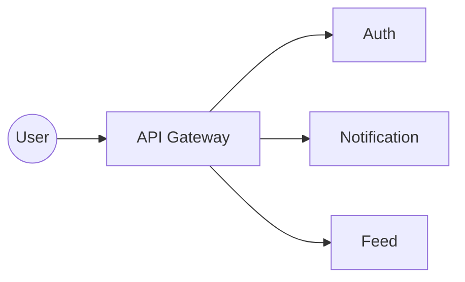
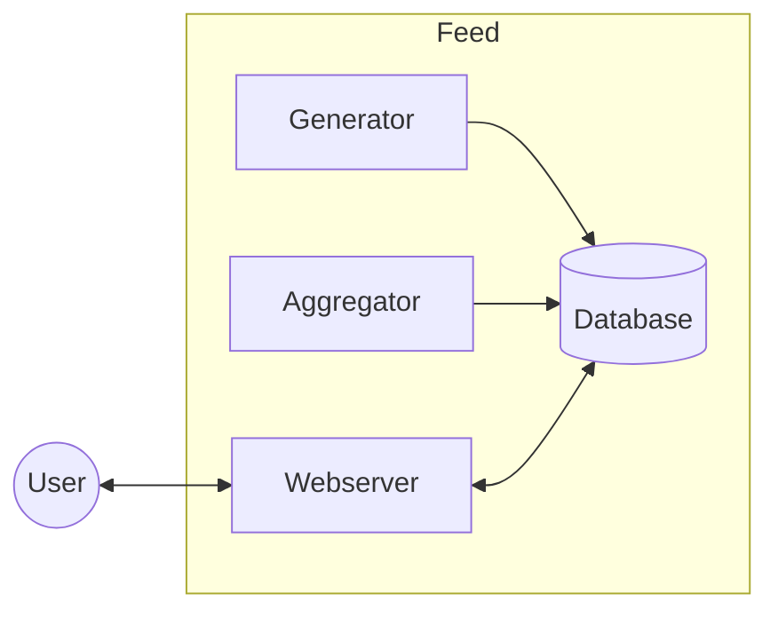
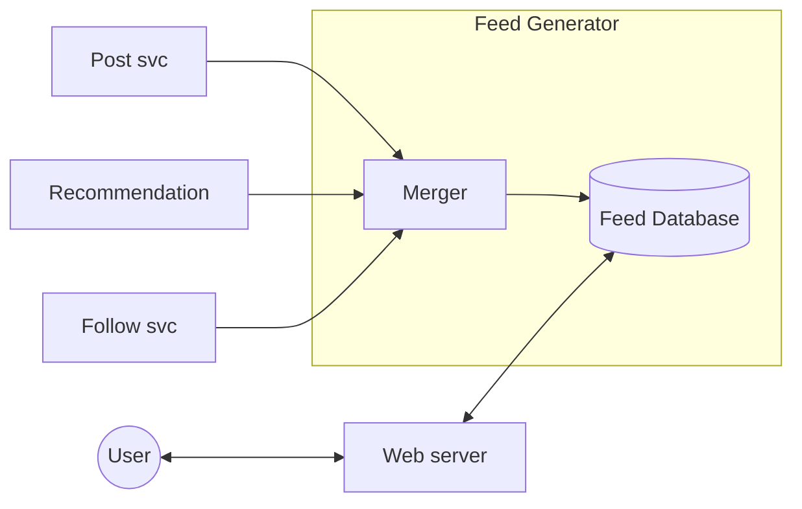

# 2. How to Approach System Design?

[← 1. What is System Design?](../basics/01-what-is-system-design.md) · [🏠 Index](../README.md) · [3. Knowing You Have Built a Good System →](../basics/03-knowing-you-have-built-a-good-system.md)

---

System Design is **extremely practical**, and there is a structured way to tackle the situations.

> **Take baby steps, no matter what!**

### Understand the problem statement
Without having a thorough understanding of the problem at hand, we would easily digress.

### Break it down into components (essential)
- **Note:** do not create components for the sake of it.
- **Note:** create components that you know are a must — *to start with*.

e.g. **Design Facebook** → Auth, Notification, Feed, Gamification *(components / features)*

### Dissect each component (if required)
*When the statement is too big.*
e.g. Feed might have — **generator, aggregator, webserver**

### For each sub-component look into
1. Database and Caching
2. Scaling & Fault Tolerance
3. Async processing (Delegation)
4. Communication

*Repeat for each sub-component, one by one.*

### Add more sub-components if needed
- understand the scope
- decide how other components will talk to this new one
- decide on the 4 above factors for this new component
- repeat

*Feed generator has dependency on other services (Post, Recommendation, Follow).*

---

[← 1. What is System Design?](../basics/01-what-is-system-design.md) · [🏠 Index](../README.md) · [3. Knowing You Have Built a Good System →](../basics/03-knowing-you-have-built-a-good-system.md)
