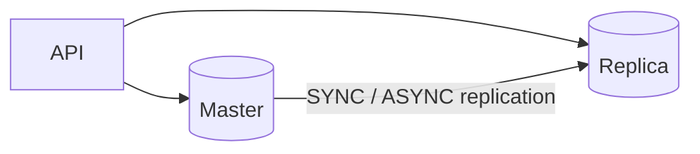
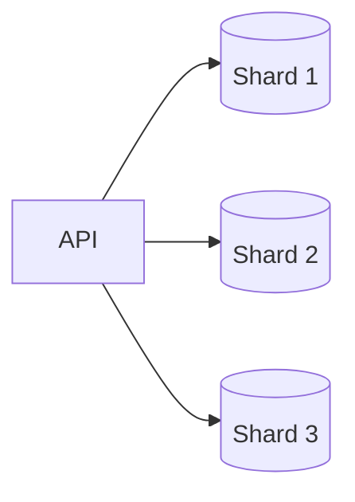

# 6. Database Scaling Techniques

[← 5. Database Isolation Levels](../basics/05-database-isolation-levels.md) · [🏠 Index](../README.md) · [7. Sharding and Partitioning →](../basics/07-sharding-and-partitioning.md)

---

Databases are the most important component of any system out there. It makes or breaks any system… Hence, it is critical to understand how to scale them…

\* These techniques are applicable to most databases out there — relational and non-relational (read your DB documentation).

### Vertical Scaling
- add more CPU, RAM, Disk to the database
- **requires downtime during reboot**
- gives you ability to handle "scale", more load
- **vertical scaling has a physical hardware limitation**

### Horizontal Scaling: Read Replicas
- when read : write = 90 : 10
- you move reads to other database so that "master" is free to do writes
- API servers should know which DB to connect to get things done

### Replication
Changes on one database (Master) need to be sent to Replica to maintain consistency.

**Two modes of replication:**

1. **Synchronous replication** — User → API → Master → Replica; write is acknowledged only after replica gets it.
   - strong consistency
   - zero replication lag
   - slower writes
2. **Asynchronous replication** — User → API → Master (ack), Master → Replica asynchronously.
   - eventual consistency
   - some replication lag
   - faster writes

### Horizontal Scaling: Sharding
Because one node cannot handle the data/load, we split it into multiple **exclusive subsets**.
Writes on a particular row/document will go to one particular shard.

This way, we scale our overall database load.
- **Note:** shards are independent — no replication b/w them.
- API server needs to know whom to connect to, to get things done.
- **Note:** some databases have a proxy that takes care of routing.
- Each shard can have its own replica (if needed).

### Exercise
1. Configure one MySQL as replica of another
2. Put some data and see the replication happening
3. Write a small API service that has two connection objects ↳ one master and one replica
4. Depending on the request, make call to either master or replica
5. Implement sharding by spinning two DBs
   - one handling keys (a to m)
   - second handling keys (n to z)
6. Write API service that routes request to one of them depending on key

---

[← 5. Database Isolation Levels](../basics/05-database-isolation-levels.md) · [🏠 Index](../README.md) · [7. Sharding and Partitioning →](../basics/07-sharding-and-partitioning.md)
