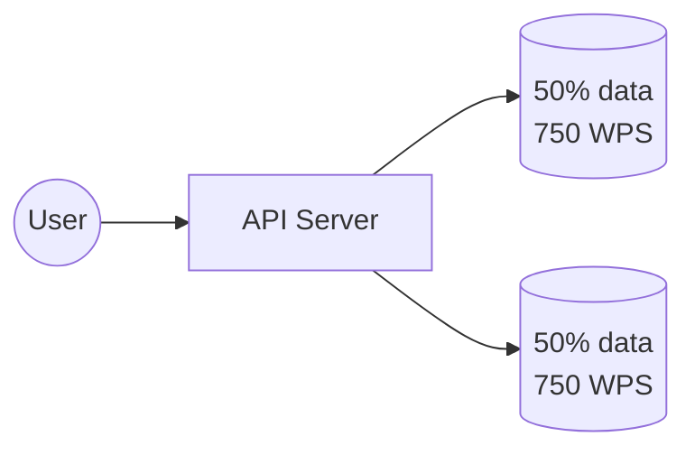

# 7. Sharding and Partitioning

[← 6. Database Scaling Techniques](../basics/06-database-scaling-techniques.md) · [🏠 Index](../README.md) · [8. Non-Relational Databases →](../basics/08-non-relational-databases.md)

---

- **Sharding:** method of distributing data across **multiple machines**. (about databases)
- **Partitioning:** splitting a subset of data **within** the same instance. (about data)

### How a database is scaled?
A database server is just a database process (`mysqld`, `mongod`) running on an EC2 machine (virtual server, e.g. MySQL listening on port 3306).

1. You put your database in production, serving real traffic: User → API Server → DB (**100 WPS**). WPS - writes per second
2. You are getting more users, that your DB is unable to manage → you **scale up** your DB… give it more CPU, RAM and Disk (**200 WPS**). *Bulkier server + Read Replica.*
3. Your product went viral and your bulky database is unable to handle the load, so you scale up again (**1000 WPS**).
4. But, after a certain stage you know you would not be able to scale "up" your DB because **vertical scaling has a limit**. So, you will have to resort to **Horizontal Scaling**.

Say, one DB server was handling 1000 WPS and we cannot scale up beyond that, but we are getting 1500 WPS — we scale horizontally and **split the data**:

By adding one more database server, we reduced the load to 750 WPS on each node and thus handled **higher throughput**.

- Each database server is thus a **shard**, and we say that the data is **partitioned**.
- Overall, a database is **sharded** while the data is **partitioned** (split across).
- *Oversimplification: most people use the terms interchangeably.*

### Example: 100 GB dataset
You partitioned the 100 GB of total data into 5 mutually exclusive partitions: **A (30GB), B (10GB), C (30GB), D (20GB), E (10GB)**.

Each of these partitions can either live on one database server or a couple of them can share one server — this depends on the **#shards you have**.

5 partitions of our 100 GB dataset distributed across 2 shards:
- **Shard 1:** A (30GB), C (30GB)
- **Shard 2:** B (10GB), D (20GB), E (10GB)

### How to partition the data?
There are two categories of partitioning:
1. **Horizontal Partitioning** (split rows) - common way of doing partitioning
2. **Vertical Partitioning** (split columns/tables) - monolith to microservices

When we "split" the 100 GB data, we could have used either of the ways, but deciding which one to pick depends on **load, use case, and access pattern**.

### Sharding vs Partitioning matrix

| | **Partitioning: No** | **Partitioning: Yes** |
|---|---|---|
| **Sharding: No** | single DB, single partition | single DB, multiple partitions |
| **Sharding: Yes** | multiple DBs each with the same data → *Read Replica* | multiple DBs, each holding different partitions |

### Advantages of sharding
- Handle large reads and writes
- Increase overall storage capacity
- Higher availability

### Disadvantages of sharding
- Operationally complex
- Cross-shard queries expensive

---

[← 6. Database Scaling Techniques](../basics/06-database-scaling-techniques.md) · [🏠 Index](../README.md) · [8. Non-Relational Databases →](../basics/08-non-relational-databases.md)
