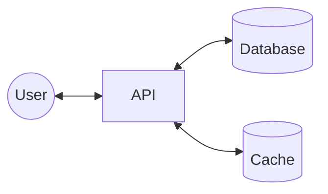

# 10. Understand Caching

[← 9. Picking the Right Database](../basics/09-picking-the-right-database.md) · [🏠 Index](../README.md) · [11. Populating and Scaling Caches →](../basics/11-populating-and-scaling-caches.md)

---

Caches are anything that helps you avoid an **expensive** network I/O, disk I/O, or computation (*Performance Improvement*):
1. API call to get profile information
2. Reading a specific line from a file
3. Doing multiple table joins

**Store frequently accessed data in a temporary storage location.**

- \* Cache is checked first.
- Fetching from DB is expensive (e.g. expensive DB query, expensive disk I/O).
- Hence, we "cache" the information in some other place (so that we do not have to go to the main database).

Caches are **faster and expensive** — \* hence we do not cache all the data (just a subset of it which is most likely to be accessed).

Caches that we typically use are **Redis, Memcached**.

> **Note:** Caches are not restricted to RAM based storage. Any storage that is "nearer" and helps you avoid something expensive is a cache for you! - like disk of API server or memory of API server.
> In their simplest form, **caches are just glorified hash tables**.

### Some examples
1. **Google News:** Most recent news articles are more likely to be accessed, hence served from cache.
2. **Auth Tokens:** Authentication tokens are cached in "cache" to avoid load on database [tokens are checked on every request].
3. **Live Stream:** Last 10 min of live stream is cached on **CDN** as it will be accessed the most.

### Exercise
1. Setup Redis locally
2. Put and get some data
3. Measure time taken
4. Compare it with database

---

[← 9. Picking the Right Database](../basics/09-picking-the-right-database.md) · [🏠 Index](../README.md) · [11. Populating and Scaling Caches →](../basics/11-populating-and-scaling-caches.md)
