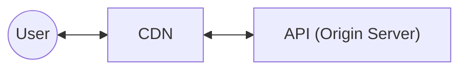

# 12. Caching at Different Levels

[← 11. Populating and Scaling Caches](../basics/11-populating-and-scaling-caches.md) · [🏠 Index](../README.md) · [13. Message Queues →](../basics/13-message-queues.md)

---

Most common cache we saw was Redis, but that is not the only type of cache out there, or not the only place that can be used as a cache.

Literally every piece/component in your infrastructure can cache something for you. **But should you?** → depends on the guarantees (<b>stale data</b> - even original data changed to serve cache till the key get expire so we show outdated data and <b>invalidation</b>). Also, **too much caching is bad!**

Bank account details - financial summary if cached, if friend did transaction still show stale data , here we should not cache - as we need consistent data.

Usually we have expire, if expired autodeleted and in next request filled with new value but sometimes need to proactively update it is called as invalidation (cricket score).
Invalidation cache - deleting key or updating key with new value.

Let's take a look at different places where we can cache.

### Client Side Caching
Storing frequently accessed data on client side (e.g. Browser, Mobile Devices, etc.) than network call.
- cache near constant data (e.g. images, JS files, user information, etc.)
- it should be okay serving cached info (stale)
- invalidation by time (expiry)

- Example: Amazon prime (can resume from where left depend on device changes)
**Massive performance boost**, as we need not make any request to backend.

### Content Delivery Networks (CDN)
*Used for caching — serving images, videos, audio, bundles, etc., and live streaming.*

CDNs are a set of servers **distributed across the world**. Request from a user goes to the nearest CDN server and hence user gets a **very quick response**.
US folks getting images from US servers is faster than fetching it from India when hosted platform on IN servers mostly static content and store cache for geographically area CDN.

\* **CDN does lazy cache population.**



User's request comes to CDN → closest server (e.g. a user in India hits the Mumbai CDN node, among US, Europe, Sydney…).
```
Nearby CDN server checks if it has the data
  if yes → return the data
  else:
      CDN makes the same request to origin server
      gets the response
      caches the response
      return the data
```
Like any other cache, when you put data on CDN you set an expiry to it (post which CDN deletes data).

```
                  CDNs      Origin Server
user (India) ->  Mumbai -> Sydney
                 US
                 Europe

CDN - geographically distributed cache & lazily populated
```

### Remote cache (Redis)
*Expensive & stores data in main memory.*

Remote cache is a centralized cache that we most commonly use (Redis). Multiple API servers use it to store frequently accessed data.
- \* Every key stored should have an expiration (memory leak)
- \* Size of cache is relatively very small as compared to a database

### Database caching
Instead of computing total posts by users every time, we store `total_posts` as a column and update it once a while (saves an expensive DB computation).

```sql
SELECT count(*) FROM posts WHERE user_id = 123;   -- expensive query
```

| id | name | … | total_posts |
|---|---|---|---|
| 123 | Arpit | | 77 |

Every time a post is published, we also update the `users` table and do `total_posts = total_posts + 1`.

> **Note:** There are other places like Load Balancer where we can cache.
> **Note:** We can cache some data at every single component in the system, but should we do it? **Not necessarily** (it is very use-case specific and subject to tolerance level of staleness of the served data).
> \* **Just because you can, does not mean you should.**

### Exercise
1. Create an account on Akamai / Cloudflare
2. Configure a simple CDN and understand how it is used
3. Cache a simple "image" on CDN and access it from CDN using CDN URL

---

[← 11. Populating and Scaling Caches](../basics/11-populating-and-scaling-caches.md) · [🏠 Index](../README.md) · [13. Message Queues →](../basics/13-message-queues.md)
