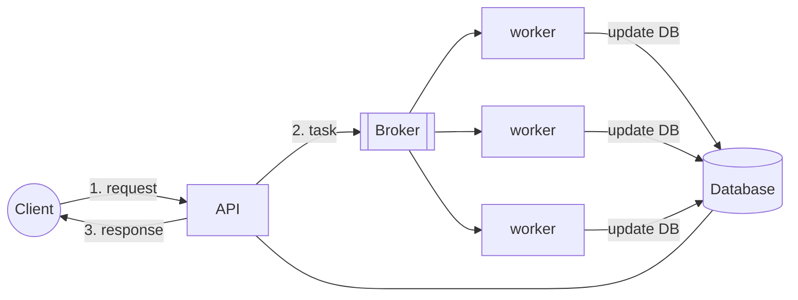
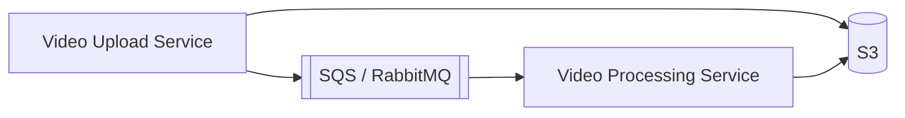
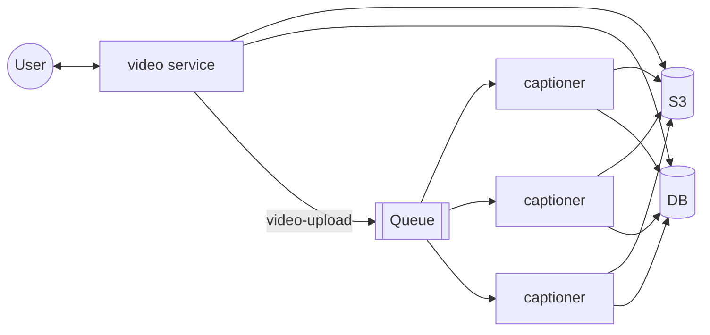

# 13. Message Queues

[← 12. Caching at Different Levels](../basics/12-caching-at-different-levels.md) · [🏠 Index](../README.md) · [14. Message Streams and Kafka →](../basics/14-message-streams-and-kafka.md)

---

### Asynchronous Processing
User sent the request and you immediately handle it — this is **synchronous**.
1. Loading insta feed is synchronous
2. Login on website is synchronous
3. Payments are synchronous

Most interactions on web are synchronous, but **some things should not be synchronous**.

e.g. **spinning up a virtual machine** — spinning up a VM takes minutes, and user will not wait on the same page waiting for the response. Instead, he/she would love to move around and keep checking status once in a while. **This is asynchronous.**

### Message Queues
Brokers help two services/applications communicate through messages. We use message brokers when we want to do something **asynchronously**:
1. Long-running task
2. Trigger dependent tasks across machines

**Example: Video processing** — once the video is uploaded we need to convert it to 360p, 480p, 720p.

Message Queues are also called **Message Brokers**.

### Features of message brokers
1. **Brokers help us connect different sub-systems.**
2. **Brokers act as a buffer for the messages** — i.e. consumers can consume at their own pace ↳ no synchronous load on connected systems.
   - e.g. Notification system: Orders Service → Queue → Email Sender
3. **Brokers can retain messages for 'n' days** (depends on broker you use). (Retention period)
4. **Brokers can re-queue the message if not deleted.**
   - e.g. consumer read the message but before it could delete it, it crashed. Then again consumed the same message by another consumers (Visibility timeout - show up again after sometime)
   - So, one msg can be served twice , i.e user will get mail twice so on. We should be okay for this sideeffect and business logic should handle this.

### Typical flow while using a message queue
**Example: Auto-subtitle (auto-captioning)**

1. User uploads video to S3 through video service
2. Video service puts a message (after upload completes) to broker
3. And returns response to the user → *user sees upload complete*
4. Message is asynchronously read by 'captioner' service
5. Captioner downloads the video
6. Captioner generates captions and updates in the DB
7. User now sees caption button enabled

### Exercise
1. Setup RabbitMQ locally
2. Write some code to push and read messages
3. Go through the documentation to understand its features

---

[← 12. Caching at Different Levels](../basics/12-caching-at-different-levels.md) · [🏠 Index](../README.md) · [14. Message Streams and Kafka →](../basics/14-message-streams-and-kafka.md)
