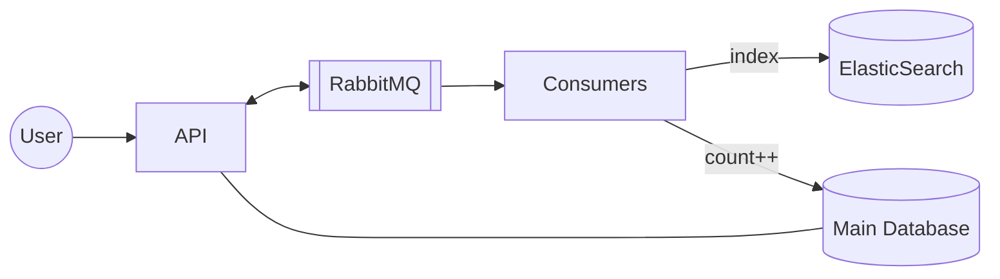
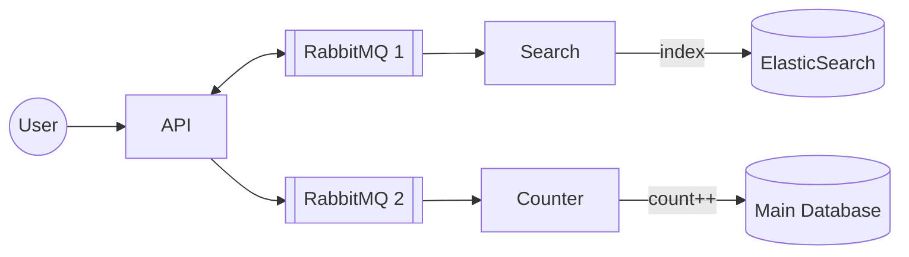
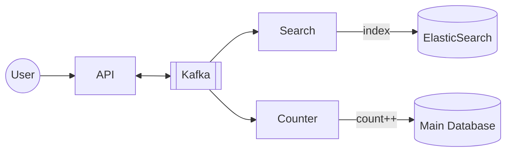

# 14. Message Streams and Kafka

[← 13. Message Queues](../basics/13-message-queues.md) · [🏠 Index](../README.md) · [15. Realtime PubSub →](../basics/15-realtime-pubsub.md)

---

Message streams (different type of consumer) are similar to message queues… (same type of consumer) with a few differences. To understand, let's take an example.

Say, we are building **Medium.com** and upon every blog published, we
- need to index it in search engine (ElasticSearch)
- need to do `count++` for user's total blogs

### Approach 1: One message broker and logic in consumer

Consumers are doing two things: `count++` and `index`.

**Issue:** what if write to one succeeded but the other one failed? `count++` ✓ but not there in search, or there in search but count does not match.

### Approach 2: Two brokers and two sets of consumers

API server writes to two brokers & each has its own set of consumers.

**This still does not solve the problem!** When API server writes to two RabbitMQs, one of them fails — we end up in the same spot.

Hence, we want **"write to one"** and **"read by many"** semantics. This is where **Message Streams** come into the picture ↳ Kafka, Kinesis.

### Message Streams
Message streams are similar to message brokers with one change: **multiple types of consumers read the same message**.

### Approach 3: Using streams and multiple types of consumers

API server pushes **one** message in Kafka; search and counter service both read the message and do their work.

### Message Queues vs Message Streams
- **Message Queues** (SQS, RabbitMQ): a message is consumed by **one** of the consumers.
- **Message Streams** (Kafka, Kinesis): messages are retained in the stream and **each type of consumer** (e.g. Search, Counter) reads all of them independently. These Search , Counter are consumer groups and each may have multiple servers. Messages are not deleted in kafka but can configure deletion policy , each consumer group iterate over messages independent of other consumer group. If new consumer group created it consume form 1st msg again.

### Kafka essentials
- Kafka is a message stream that holds the messages.
- Internally Kafka has **topics**.
- Every topic has **'n' partitions**.
- Message is sent to a topic, and depending on the configured **hash key** it is put into a partition.
e.g: 10k users, 3 partitions and each may handle 3.3k users and same user message always go to same partition based on key.
- **Within a partition, messages are ordered** ↳ no ordering guarantee across partitions.

### Limitation of Kafka
**#consumers = #partitions** (max useful consumers in a group).
 
- Partition and Consumer are one to one mapping, one consumer can iterate one partition or one partition can be read by one consumer only.
But can have different consumer group for same partition but same consumer group can have only one consumer for one partition. We can have one consumer for 3 partitions and if 2 consumer then one partition will be dedicated for one consumer.

- After reading some messages , we commit to kafka so from next time after consumer restart after crash it start from exact same point. We commit here after processing the msg whereas in msg queue we delete after processing the msg

- deletion policy , each consumer have different commit point. So each consumer consume its own pace time.

e.g. topic with #partitions = 3 → search consumers 1, 2, 3 each get a partition; additional consumers (4, 5) — **no messages would be sent to them**.

### Exercise
1. Setup Kafka locally
2. Write some code to push and read messages
3. Go through the documentation to understand its features

---

[← 13. Message Queues](../basics/13-message-queues.md) · [🏠 Index](../README.md) · [15. Realtime PubSub →](../basics/15-realtime-pubsub.md)
