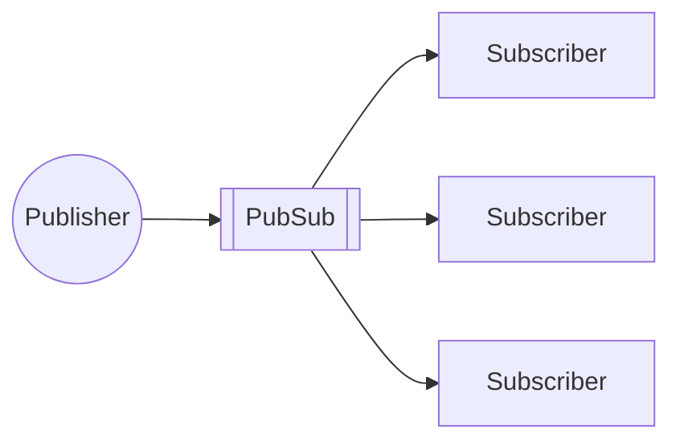

# 15. Realtime PubSub

[← 14. Message Streams and Kafka](../basics/14-message-streams-and-kafka.md) · [🏠 Index](../README.md) · [16. Load Balancers →](../basics/16-load-balancers.md)

---

Both message brokers and message streams require consumers to **"pull"** the messages out.
- **Advantage:** consumers can pull at their own pace; consumers do **not** get overwhelmed.
- **Disadvantage:** consumption lag when high ingestion.

What if we want **low latency & zero lag?** → **Realtime PubSub** (makes things reactive instead of continuous polling).

Instead of consumers pulling the message, the message is **pushed** to them (pushed to all subscribers, so they get msg published immediately). e.g. **Redis PubSub**.
- This way we get really fast delivery time.
- But it can overwhelm the consumers ↳ what if consumers receive messages faster than they could process?

**Practical use case:** Message Broadcast, Configuration Push — all servers receive updates without polling for data.

### Exercise
1. Setup Redis locally
2. Go through Redis PubSub documentation
3. Test realtime broadcast
4. Test if it persists the message (check if new subscriber gets old messages)

- No, Redis Pub/Sub does not persist messages. A new subscriber will not receive old messages published before it subscribed. It receives only new messages published after subscribing. As it don't buffer.

| Feature | Persists messages? | Can a new consumer read old messages? |
| --- | --- | --- |
| Redis Pub/Sub | No | No |
| Redis Streams | Yes | Yes |
---

[← 14. Message Streams and Kafka](../basics/14-message-streams-and-kafka.md) · [🏠 Index](../README.md) · [16. Load Balancers →](../basics/16-load-balancers.md)
