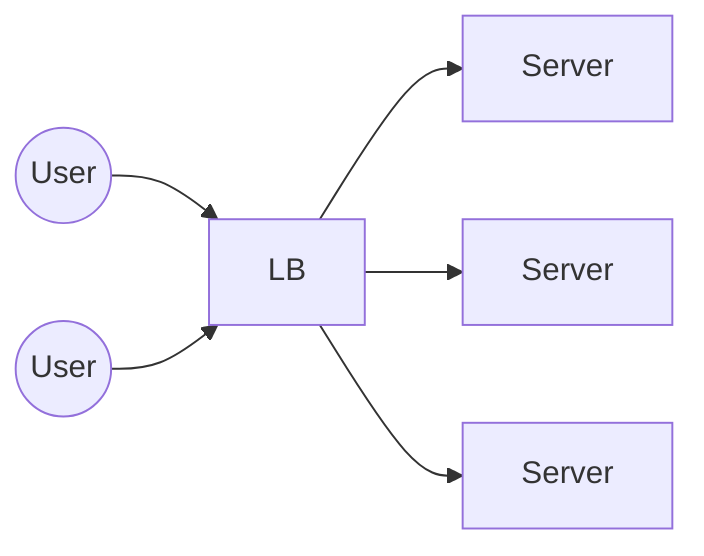

# 16. Load Balancers

[← 15. Realtime PubSub](../basics/15-realtime-pubsub.md) · [🏠 Index](../README.md) · [17. Circuit Breakers →](../basics/17-circuit-breakers.md)

---

One of the most important components in a distributed system that makes it easy to **scale the load horizontally**.
\* Load Balancer is the **only point of contact**.

Every load balancer has either a **1. static IP** or **2. static DNS name**, allowing clients (users/servers) to talk to it.

Load balancer **hides the #servers** that are "behind" it, allowing us to add as many servers as possible without the client knowing about it → **Horizontal Scalability**.

### Request Response Flow
1. Client already has IP/domain of load balancer (e.g. `auth.example.com`)
2. Client makes API call and it comes to load balancer (e.g. `GET auth.example.com/login`)
3. Load balancer picks one server and makes the same request
4. Load balancer gets the response from the server
5. Load balancer responds back to the client

The job of the load balancer is to **"balance" the load** → it depends on how it picks the server to forward the request (configurable).

### Load Balancing Algorithms
| Algorithm | How | When |
|---|---|---|
| **Round Robin** | Distribute the load iteratively (S1 → 1,4; S2 → 2,5; S3 → 3,6) | Uniform infrastructure |
| **Weighted Round Robin** | Distribute the load iteratively but as per weights (bigger server gets more request) (S1 → 1,5; S2(bigger server) → 2,3,6,7; S3 → 4,8) | Non-uniform infrastructure |
| **Least Connections** | Pick the server having the least connections from the load balancer (S1 → 1,5,7; S2 → 2,4,8,9; S3 → 3,6,10) | When response times have a big variance 5min vs other response time of request is 0.2s (\* Analytics) |
| **Hash based routing** | Hash of some attribute (IP, user id, URL) determines which server to pick  (S1 → 1,3,5; S2 → 4; S3 → 2,6) | "random enough" |

### Key advantages of Load Balancers
- **Scalability:** With more servers behind load balancer we can now handle more requests (2 servers × 100 RPM = 200 RPM → 3 servers = 300 RPM).
- **Availability:** Even if one of the servers crashes, it does not take down our entire system. Load balancer will forward requests to other **healthy** servers, improving the availability. (With S2 down, load balancer will forward any new request to S1 and S3.)

### Exercise
Go through AWS Load Balancer's documentation.

---

[← 15. Realtime PubSub](../basics/15-realtime-pubsub.md) · [🏠 Index](../README.md) · [17. Circuit Breakers →](../basics/17-circuit-breakers.md)
