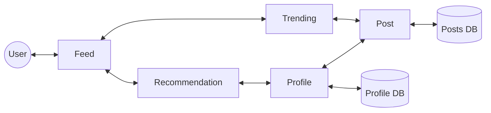
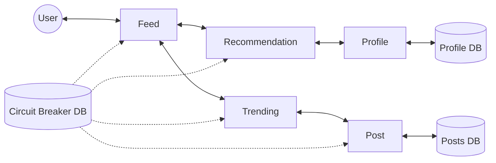

# 17. Circuit Breakers

[← 16. Load Balancers](../basics/16-load-balancers.md) · [🏠 Index](../README.md) · [18. Data Redundancy and Recovery →](../basics/18-data-redundancy-and-recovery.md)

---

Circuit Breakers prevent **CASCADING FAILURES!!** - fail in one place fail next service and fail next dependent service so on.

Say, you are building a social network that serves feed for a user:
1. User's request comes to Feed Service
2. Feed service pulls some info from Recommendation, some from Trending
3. Recommendation and Trending both rely on Profile service ↳ to get profile detail of user who made the post
4. Recommendation and Trending depend on Post service ↳ to get details of the post

There are lots of other services that depend on profile service. If profile service DB is **overwhelmed!!** it slows down and transitively all services dependent on it are affected — **"Timeouts"** [higher response times].

This leads to:
1. Complete outage
2. Unresponsiveness → *poor user experience*

**Idea:** What if we make a call to a service **only if it is healthy?** → This is **Circuit Breaker** — we break the circuit down when we see the failure cascade!

Circuit Breakers prevent the entire product from collapsing by preventing cascading failures.

### How is it implemented?
- A common database holds the settings for each breaker
- Services, before making calls to others, check the config ↳ cache the config to avoid checking the DB

In case of the outage, the circuit is **tripped** and DB updated. Services will periodically check and stop sending requests to affected services.

### Exercise
- Implement a simple circuit breaker (DB) — \* see if you can use Redis PubSub here for reactive/ realtime + cache in each API server?
- Write a simple service that checks this setting every time before calling
  - e.g. post service serves post, profile service serves profile; post service calls profile for info; if circuit is tripped, do not make call to profile

---

[← 16. Load Balancers](../basics/16-load-balancers.md) · [🏠 Index](../README.md) · [18. Data Redundancy and Recovery →](../basics/18-data-redundancy-and-recovery.md)
