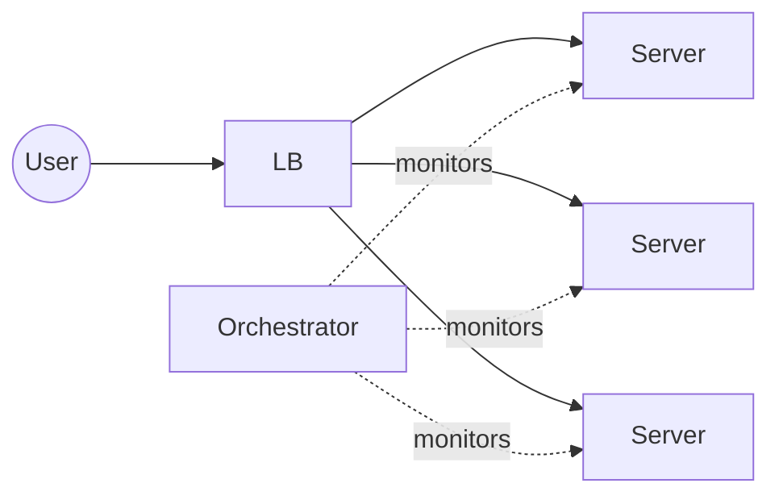

# 19. Leader Election for Auto-Recovery

[← 18. Data Redundancy and Recovery](../basics/18-data-redundancy-and-recovery.md) · [🏠 Index](../README.md) · [20. Client Server Model and Communication Protocols →](../basics/20-client-server-model-and-communication-protocols.md)

---

Say, we have a bunch of servers serving HTTP requests. When one of them goes down, we have to spin up a new one. Doing this is the responsibility of another module, say **orchestrator**.


Orchestrator keeps an eye on the servers. When one goes down, orchestrator spins one and adds.
- \* No human intervention
- \* minimal time – outage!

**But what if orchestrator is down? Who monitors it?**
↳ we need orchestrator for orchestrator ↳ who monitors ↑ ↳ another orchestrator?? — **This goes out of hand quickly!**

Hence, we need an **automated way to recover the system** ↳ when one orchestrator is down, somehow other orchestrator comes back up and takes responsibilities.

### Leader Follower Setup (Autorecovery)
We run orchestrator in **leader-follower mode** — multiple nodes running the orchestrator code; one leader while others are workers/followers.

- Leader keeps an eye on workers. If a worker dies, leader spins up a new one.
- Workers ping the servers and check if they are healthy.
- If orch worker finds a backend server is unhealthy, it spins a new one.
- If orch leader finds that orch worker is unhealthy, it spins a new one.
- If orch worker finds orch leader is dead, they **trigger a leader election** and system is auto-recovered.

How workers will choose a leader depends on the **leader election algorithm**.

> **Note:** This is a generic concept and we can apply it to any system that needs an ability to auto-recover.

## Scenario: One Orch Leader and One Orch Worker

### Step 1: Leader A crashes

- Worker B detects that Leader A is no longer responding.
- Worker B triggers a leader election.
- Worker B wins the election and becomes the new leader.

### Step 2: Worker B becomes the leader

- Leader B takes responsibility for monitoring orchestrator workers.
- Leader B detects that the previous worker capacity needs to be restored.
- Leader B starts a new worker, Worker C.
- Worker C begins monitoring backend servers.

### Final state

text
```
Before failure:

Orchestrator Leader A
        |
        | monitors
        v
Orchestrator Worker B

After Leader A crashes:

Orchestrator Worker B
        |
        | leader election
        v
Orchestrator Leader B
        |
        | starts replacement
        v
Orchestrator Worker C
```

### Important distinction

Leader election and worker recovery are two separate operations:

1. Leader election: Selects an existing node to become the new leader.
2. Worker recovery: The new leader starts a replacement worker to restore redundancy.

Note: In production, use a reliable leader-election mechanism with leases or fencing to prevent two nodes from acting as leader simultaneously if the old leader is still running but unreachable.

| Algorithm | Best use case | Complexity | How it works |
| --- | --- | --- | --- |
| Raft | Production distributed systems | Medium–High | Nodes elect a leader using terms and votes. A candidate needs a majority of votes. If the leader fails, the remaining nodes elect a new one. |
| Bully Algorithm | Learning and simulating leader election | Low–Medium | When a node detects leader failure, it contacts nodes with higher IDs. The highest-ID active node eventually becomes the leader. |
| ZooKeeper / ZAB | Systems using ZooKeeper for coordination | Medium | Nodes use ZooKeeper's coordination mechanisms to elect a leader. ZAB (ZooKeeper Atomic Broadcast) coordinates consistent updates among ZooKeeper servers. |
| etcd-based election | Production systems using etcd | Low when using its election API | Nodes compete for leadership using etcd's coordination API and leases. If the leader's lease expires, another node can acquire leadership. |

### Exercise
Simulate leader failure & run leader election. Workers = threads (no need of multiple machines).


---

[← 18. Data Redundancy and Recovery](../basics/18-data-redundancy-and-recovery.md) · [🏠 Index](../README.md) · [20. Client Server Model and Communication Protocols →](../basics/20-client-server-model-and-communication-protocols.md)
