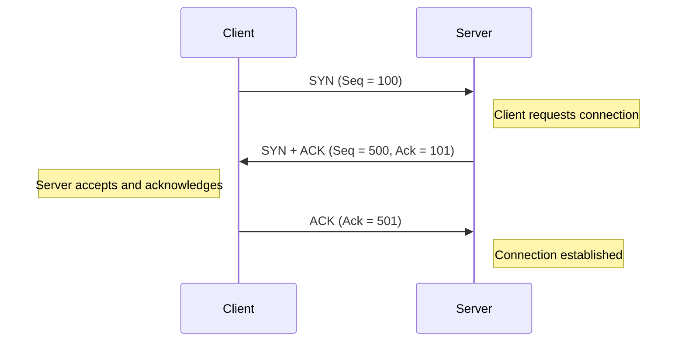
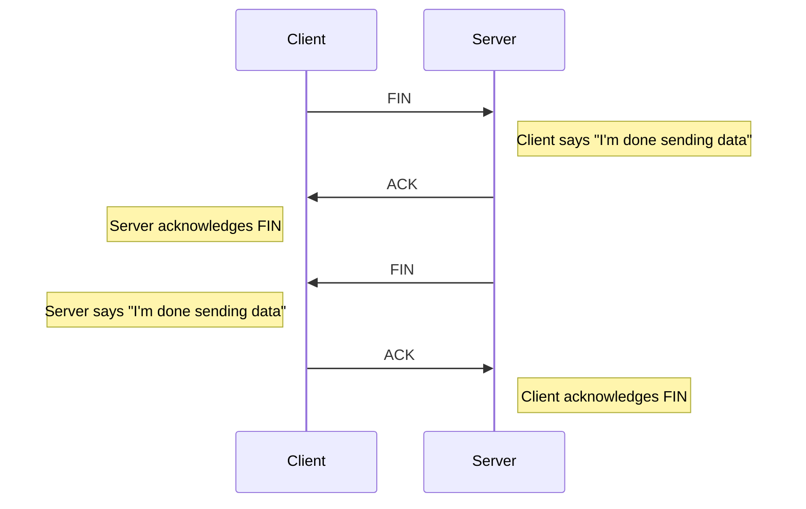

# 20. Client Server Model and Communication Protocols

[← 19. Leader Election for Auto-Recovery](../basics/19-leader-election-for-auto-recovery.md) · [🏠 Index](../README.md) · [21. Blob Storage and S3 →](../basics/21-blob-storage-and-s3.md)

---

### Client Server Model
Most common way for two machines to talk to each other.
- **Client (C)** → demands; **Server (S)** → does the job
- e.g. give me my profile info; delete the post I made; spin up one server

The communication happens over the common network connecting the two.
Two protocols to exchange data: **TCP** and **UDP** (we almost 99.99% times use TCP).

- Almost all webserver backend application listen over TCP - communication layer between is reliable, retransmission and quality.

### Some important properties of TCP
1. TCP connection requires **3-way handshake** for setup - packet movement thrice
2. TCP connection requires **2-way handshake** for teardown
3. TCP connection does not break immediately after data is exchanged
   - ↳ breaks because of network interruption
   - ↳ breaks because server/client initiated it

Hence connection remains open… almost "forever" till any of party terminate.

  

| Flag | Full form      | Purpose                        |
| ---- | -------------- | ------------------------------ |
| SYN  | Synchronize    | Establish a connection         |
| ACK  | Acknowledgment | Confirm receipt                |
| FIN  | Finish         | Gracefully close one direction |
| RST  | Reset          | Abruptly reset a connection    |
| SYN + ACK | | Server acknowledges the client's request and sends its own synchronization request |

### Protocol over TCP
TCP does not dictate what data can be sent over it. A common format agreed upon by client & server is called a **protocol: HTTP**.

HTTP is just a format that client and server understand.
\* You can define your own format, and make
1. your client send data in it
2. your server parse & process it (e.g. `"GET_K\n"`)

### Properties of HTTP 1.1
There are many versions of it — HTTP 1.1 / HTTP 2 / HTTP 3. HTTP 1.1 is the most commonly used one.
1. For client and server to talk over HTTP 1.1, they need to establish TCP connection
2. Connection is typically **terminated** once response is sent to client
3. Almost new connection for every request/response ↳ little expensive
4. Hence people pass `Connection: keep-alive` header, which tells client and server to not close the connection (\* depends if server follows it or not)

### WebSocket
WebSockets are meant to do **bi-directional communication**.
**Key feature:** Server can proactively send data to client, without client asking for it.

Because there is no need for setting up TCP every single time, we get **really low latency** in communication (vs HTTP 1.1 which repeatedly sets up / tears down connections).

Anywhere you need "realtime", "low latency" communication for your end user **over the internet**, think about websockets.
e.g. Chat, realtime likes on live stream, stock market ticks.

Chat - socket vs TCP

<pre>
SOCKET
user   ------- (handsake)    user
       -------
       ======= (packet
       =======  transfer)
       =======
       =======
       =======
       _______
       _______ (teardown)

HTTP 1.1 (overhead)
user   ------- (handsake)    user
       -------
       -------
       ======= (packet
       =======  transfer)
       _______
       _______ (teardown)
       ------- (handsake)     
       -------
       -------
       =======
       =======
       _______
       _______ (teardown)

</pre>

- Persistant connection are costly and overhead so using it based on requirements.

### Exercise
- Build a chat application using Socket.IO

---

[← 19. Leader Election for Auto-Recovery](../basics/19-leader-election-for-auto-recovery.md) · [🏠 Index](../README.md) · [21. Blob Storage and S3 →](../basics/21-blob-storage-and-s3.md)
