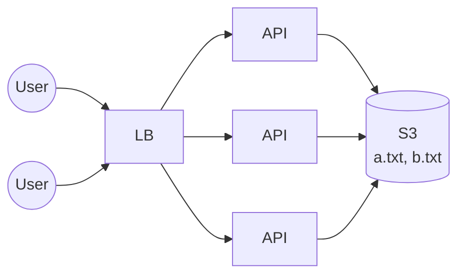
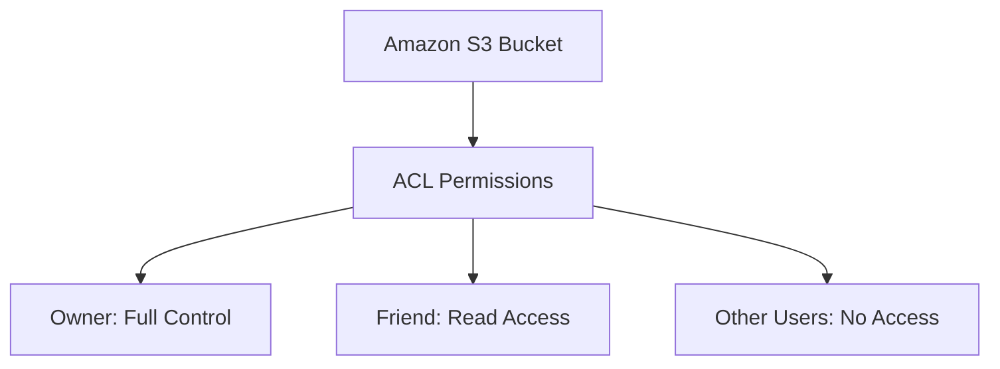

# 21. Blob Storage and S3

[← 20. Client Server Model and Communication Protocols](../basics/20-client-server-model-and-communication-protocols.md) · [🏠 Index](../README.md) · [22. Bloom Filters →](../basics/22-bloom-filters.md)

---

Earlier when people uploaded any files, they uploaded it to "server" and they were stored on the hard disk attached to it. Getting a file was simple: make an API call, the handler reads the file & returns.

\* This is precisely how `/static` folders/routes worked:
- When user uploads the file `a.txt` → accept it on HTTP POST → create absolute path using folder mapped to `/static` (`/home/arpit/www/static/a.txt`) → store the file at ↑ location.
- When user requests `/static/a.txt` → get the path from URL → create absolute path `/home/arpit/www/static/a.txt` → read the file and return.

*(Early days of the internet.)* This worked well for quite some time, but **won't work with multiple servers** because each server will have its own disk (a.txt on one server, b.txt on another behind the load balancer).

Hence, we need an **infinitely scalable network attached storage / file system** → This is **S3 / Blob Storage**.

Any "file" that needs to be accessible by any server is stored at a place accessible by all. **Our API servers are now stateless.**

On S3 you have:
- **buckets:** (namespace) e.g. `insta-images`, `my-bucket` (any unique name)
- **keys:** path of the file within bucket

`s3://insta-images/user123/72896.png` → bucket = `insta-images`, key = `user123/72896.png`

You can seamlessly create the file, replace the file, delete the file, read entire file or segment of it — **not a full-fledged file system**.

### Advantages
- cheap, durable storage
- can store literally any file (images, video, audio, text, DB backup, DB CSV exports, anything)
- scalable and available
- integration with a lot of AWS and Big Data services

### Disadvantages
- reads on S3 are slow — so if you want quick reads, you **should not** use S3 ↳ SSD and HDD attached to instances are better
- not a full-fledged file system

You should use S3 when you want to store a 'blob' that is centrally accessible:
- Database backups
- Logs archival
- Static website hosting
- Infrequently accessed data dumping ground
- Big Data storage

### ACL in Amazon S3

**ACL stands for Access Control List.**

It is a mechanism used to control **who can access an S3 bucket or object and what permissions they have**.

An ACL can specify these access permissions.

#### 1. Common S3 ACL Permissions

| Permission | Meaning |
|---|---|
| `READ` | Allows reading an object or listing a bucket's contents, depending on the resource. |
| `WRITE` | Allows writing objects to a bucket. |
| `READ_ACP` | Allows reading the ACL permissions. |
| `WRITE_ACP` | Allows modifying the ACL permissions. |
| `FULL_CONTROL` | Allows all the ACL permissions above. |

#### 2. How S3 ACL Works

#### 3. ACL vs Bucket Policy

| Feature | ACL | Bucket Policy |
|---|---|---|
| Format | Access grants | JSON policy |
| Controls access to | Buckets and objects | Bucket and objects within it |
| How it works |Grants basic permissions to specific users or groups | Defines detailed rules for who can access S3 resources|
| Permission detail | Relatively limited | More flexible |
| Recommended use | Specific legacy or object-ownership cases | Most S3 access-control use cases |

Amazon S3 generally recommends disabling ACLs using **Bucket owner enforced** Object Ownership. In this configuration, access is managed through IAM policies and bucket policies rather than ACLs.

**ACL defines who gets access through access grants, while a bucket policy defines access rules using JSON.**

### Exercise
1. Go through S3 documentation or explore the API
2. Read about ACL on S3
3. If possible, play around with its API

---

[← 20. Client Server Model and Communication Protocols](../basics/20-client-server-model-and-communication-protocols.md) · [🏠 Index](../README.md) · [22. Bloom Filters →](../basics/22-bloom-filters.md)
