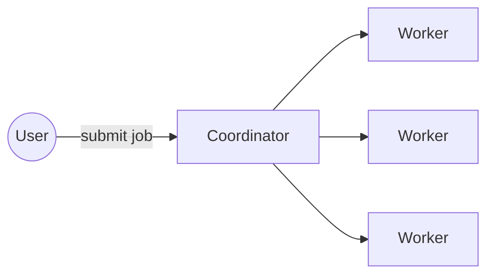
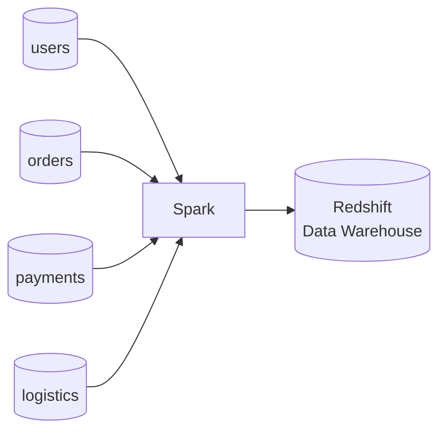
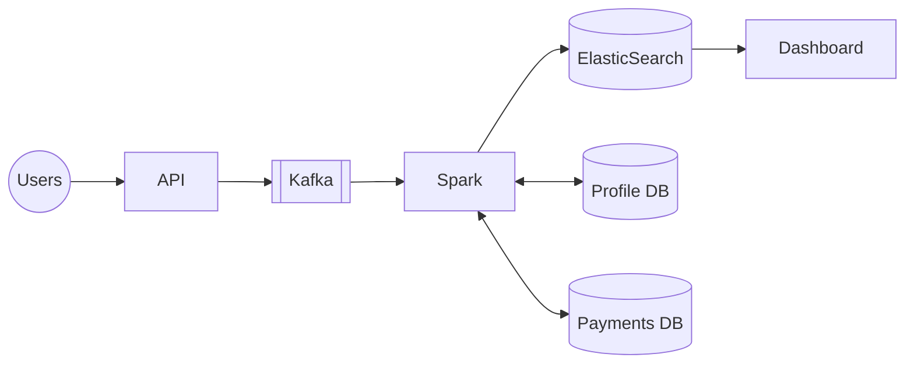

# 24. Introduction to Big Data Processing

[← 23. Consistent Hashing](../basics/23-consistent-hashing.md) · [🏠 Index](../README.md) · [1. Designing E-commerce Product Listing →](../case_studies/01-designing-e-commerce-product-listing.md)

---

When one machine is not enough to process the data, we **divide and conquer** → This essentially is Big Data Processing!

Companies use this to process massive amounts of data and extract insights out of it, train ML models, move data across databases, and much more.
- When too much data needs to be processed quickly, we use Big Data tools.
- \* All these fancy processing on **commodity hardware**.

### Counting word frequency
Given a 1 TB text dataset, find frequency of each word.

**Approach 1: Simple**
1. Load data on one machine (disk)
2. Read it character by character
3. When space is encountered, update in-mem hash table, do `count++` (`word_freq[word] += 1`)

This is a simple approach that runs in O(n) time approx. But because only one machine is doing it, it will take a long time. So, can we parallelize it? Yes… add threads…

**Approach 2: Threads**
You can easily parallelize the code; each thread can handle a chunk of the file/dataset and can do `word_freq[word] += 1`.

But, what if the dataset is not 1 TB but **100 TB**? (big data or smaller hardware)
- ↳ something that does not fit on a single machine, or
- ↳ even if it did, it is slow to compute
  - ↳ threads are bounded by CPU cores
  - ↳ limited computational capabilities of underlying hardware

Instead of one machine, can we distribute the workload across multiple (often smaller) machines ↳ and leverage parallelism?

**Approach 3: Distributed Computing**
More computers, more CPU, more processing.
Idea:
- split the file into 'partitions'
- distribute the partitions across all servers
- let each server compute word freq independently
- send word freq to one server (coordinator)
- merge the word freq
- return the result


- User submits the job to 'coordinator'
- Coordinator distributes the job across multiple machines
- Machines compute and send result to coordinator
- Coordinator merges and returns

### Challenges
1. What about failures?
2. What about completion?
3. What about recovery?
4. What about scaling & distribution?

Although we can always do it on our own, but if there are tools to manage this for us… **adopt it**.

Big Data Tools manage these complexities for us (↳ we just write the business logic):
- distribute across machines
- knowing which machines are doing what
- retrying in case of failures
- reprocessing in case of crashes or corruption
- cleaning up the resources once job is complete

### Spark and Flink
Large scale data processing on commodity hardware. It has connectors to a lot of databases and infra components.

**e.g.** combine user, order, payments and logistics DBs and put the result in AWS Redshift (Data Warehouse):


**e.g.** when any activity is happening, events are streamed to Kafka. In realtime enrich the events and put them in analytics DB to track in realtime (too slow if one machine does it):


There are a plethora of tools available, each solving a niche problem — **but the overall concept remains the same**. It is easy to get overwhelmed by the ecosystem… but (don't).

### Exercise
1. Setup Spark locally (\* refer to any series on YouTube and get started)
2. Take some sample datasets
3. Write Spark jobs to process the data (\* Recommend: Sales data → lots of stats and analytics)
4. Write a Spark job that
   - reads from Kafka (each event has `user_id`)
   - for each event it goes to users DB to get detail
   - Spark job should enrich and dump data on disk as JSON file

   e.g. Kafka event `BLOG_PUBLISHED` (topic), payload `<user_id, blog_id>`; user detail in user DB `{name, email, bio}`.
   Output:
   ```json
   { "user_id": "...", "blog_id": "...", "user": { "name": "...", "email": "...", "bio": "..." } }
   ```

---

[← 23. Consistent Hashing](../basics/23-consistent-hashing.md) · [🏠 Index](../README.md) · [1. Designing E-commerce Product Listing →](../case_studies/01-designing-e-commerce-product-listing.md)
