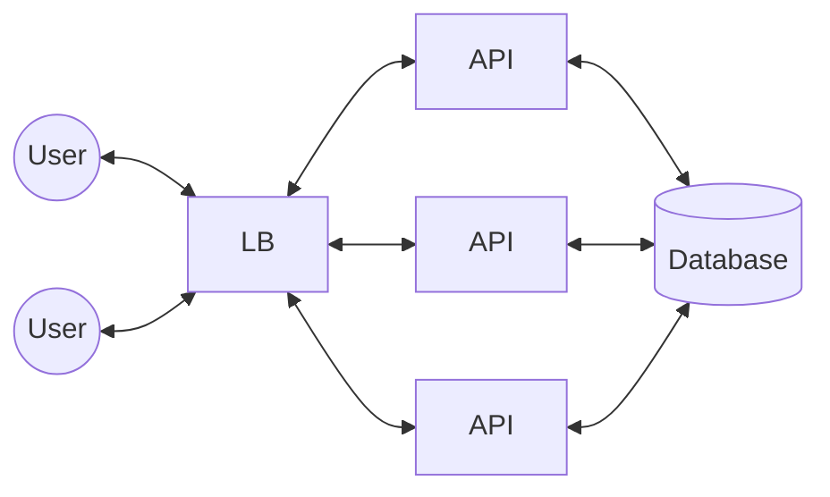
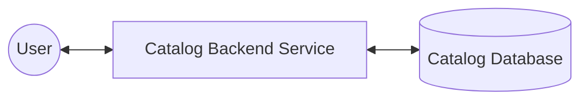
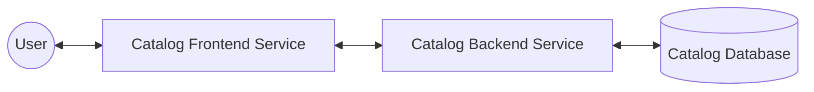
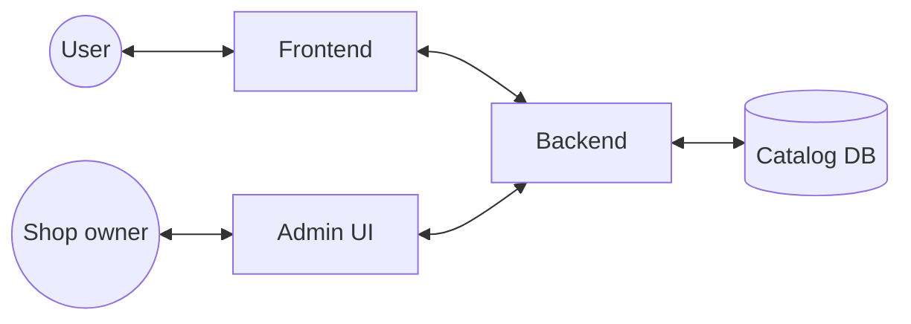
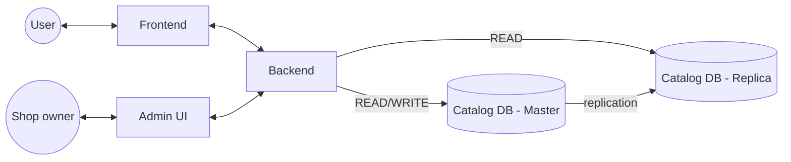

# 1. Designing E-commerce Product Listing

[← 24. Introduction to Big Data Processing](../basics/24-introduction-to-big-data-processing.md) · [🏠 Index](../README.md) · [2. Designing a Rate Limiter →](../case_studies/02-designing-a-rate-limiter.md)

---

For a small shop (100 items) design a system through which the shop owner can:
1. add a new product
2. update/delete existing product
3. list all the products on the website
4. customers should be able to quickly access the catalog

\* Payment is out of scope for this problem statement.

### Storage
100 × 1 KB ≈ 100 KB data
- not huge data, only 100 rows (fits on single node)
- there seems to be a structure

We can go ahead with **SQL DB** — a `products` table to hold all the catalog.

### Serving the data
- simple REST based HTTP webserver is fine
- we will need many (handle large requests)
- hence put a load balancer

Load Balancer will have DNS like `api.mystore.com`.

### Architecture until now

✓ storing the data ✓ serving the data. *API servers ← mostly backend API servers.*

\* Instead of drawing LB and multiple servers every time, we simply draw the above diagram as:

End user will not directly interact with backend; needs a **frontend**:

### Shop owner's admin interface
Shop owner needs Admin Console to manage the catalog. We can keep the Admin UI a separate frontend service which interacts with the same Backend service to do admin things.

✓ list product on website. \* In real world, early stage startups would do all this in one service.

Let's understand the load on each component: load on frontend? load on backend? load on Catalog DB? load on Admin UI?

### Scaling DB
When a lot of load comes in, the DB will be under heavy load. Given the use case is to **list the pages**, the load is certainly **Read load**, hence we add **Read Replica**.

✓ access catalog quickly

### Exercise
1. Design DB schema for this system
2. Write a simple backend API service exposing APIs
3. Setup DB replication
4. Move read APIs to read from Replica
5. Add a cache
6. Update catalog & invalidate the cache 

---

[← 24. Introduction to Big Data Processing](../basics/24-introduction-to-big-data-processing.md) · [🏠 Index](../README.md) · [2. Designing a Rate Limiter →](../case_studies/02-designing-a-rate-limiter.md)
