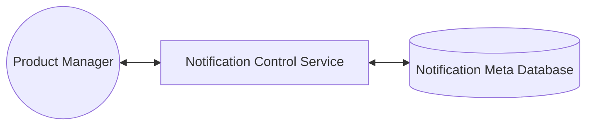
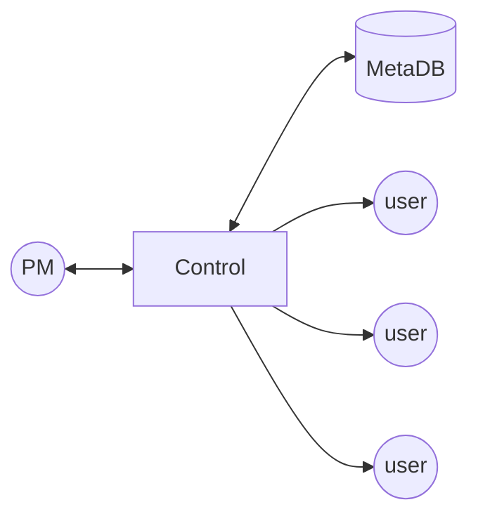
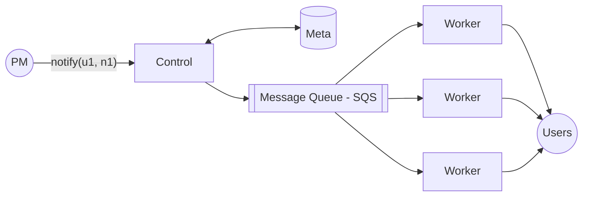
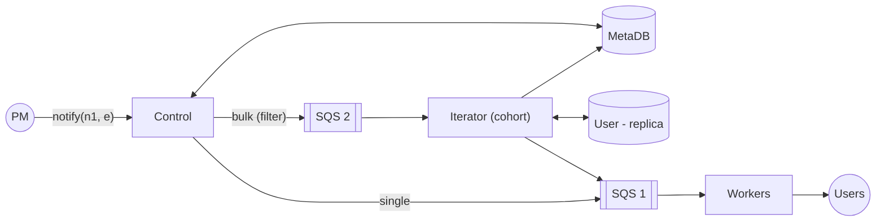
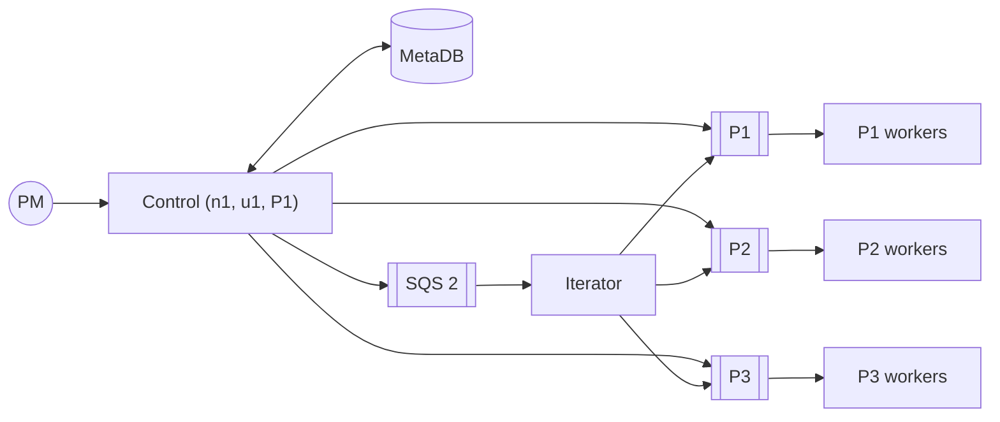

# 3. Designing a Notification Service

[← 2. Designing a Rate Limiter](../case_studies/02-designing-a-rate-limiter.md) · [🏠 Index](../README.md) · [4. Designing Realtime Abuse Masker →](../case_studies/04-designing-realtime-abuse-masker.md)

---

> **Motive:** Designing an extensible system and reading unsaid requirements.

Design a notification service that sends notifications to users across channels. The system needs to be **horizontally scalable** and should support a **very high fan-out**.

Instead of directly jumping to send "millions" of notifications, let's start simple.

### Notification Template
We need a UI and simple backend to create notification templates that will be configured by some internal team.
Number of notification templates (with placeholder for specific for user - personalized) will not be huge and will fit on a single machine. Hence, we start with **relational DB**.

Notification Meta DB stores all templates, e.g. Jinja template - *"Hello {{user.name}}, Order from XYZ and get {{discount}} off!!"* (atmost will be 10k templates for example at max) -

When any team/product wants to send a notification:
1. create a template using the Notification Control Service
2. specify the variables
3. note the ID of the defined template

### Notification Channels
User can be notified via multiple channels:
1. email
2. android push notification
3. apple push notification
4. SMS

For each of these channels there are providers that expose APIs. We invoke them programmatically to send notification at the very instant.
Some examples: SES, Mailgun, OneSignal, Twilio, msg91, etc.

So, the servers that will send/trigger the actual notification will have to configure their SDKs/libraries.

> **Note:** The API calls (of providers) are expensive network calls with high latencies ↳ one machine will not be able to make millions of concurrent network calls.

### Simple Notification Flow (one user)
1. PM creates notification template
2. PM triggers notification, the control service (\* creates notification body) notifies the user instantly

\* **What if PM wants to trigger thousands of notifications at the same time?**
1. Triggering one notification for every user is pain for PM
2. Control service becomes the bottleneck (network call takes time) + provider outage?

This is a classic place of making things **asynchronous**.

### Asynchronous
Sending notifications to thousands of users synchronously (through control service) is a bad idea!
And if provider is down we use control service to do synchronous then it get CPU / network bandwidth hopped because of retries. Make the control service expensive.

Control service will fill the template getting from DB and send to SQS. Worker will have SDK of twilio, mailgun so on.

Message contains `<u1, body, channel>`. **Keeping workers dumb.** - don't have DB connection or business logic
This architecture solves retries and does not overwhelm Notification Control.

Retries happens in worker, if retry failed then , after visibility timeout again appear in SQS and try again unless deleting msg it guarantee delivery of message.

### Bulk Notification
Above architecture works well when we have moderate traffic and notifications are triggered one by one. A typical use case: **'Notify everyone'**.

User experience: PM submits a job to notify everyone and we need to take care of everything else.

**Approach 1: control server iterates**
- ↳ iterating through million rows takes time
- ↳ plus it eats up control service, whose responsibility is to accept "notification requests"

**Approach 2: control server delegates iteration**

Iterator iterates through users, filters out on criteria, pushes notification to SQS 1.
- **SQS 1 FIFO:** Notification Emitter
- **SQS 2 FIFO:** User iterator, and anything that requires some processing

Eg, 
1. Last 7 days not logged in users
2. Users living in Bangalore.

### Important notifications ( As queues are FIFO)
Some notifications are more important than others, e.g. *Appointment Reminder >>> Marketing push*.

In our current architecture, one marketing campaign will keep executors busy and all other notifications will **starve** in the queue.

To solve this: instead of having one Notification Emitter Queue, have multiple — **priority wise (P1, P2, P3)** & each having its own set of workers.

u1 - user

n1 - notification

p1 - priority

- ✓ Horizontal scalability – add more queues, add more workers for each queue as required.
- ✓ Load isolation and avoiding starvation (solved to send appointment msg faster not waiting for marketing notifications to finsih)
- ✗ **Duplicate notifications**

### Avoiding duplicate notifications
It is really irritating to receive marketing notifications, and it is the worst if we receive multiple of the same campaign.
- Getting transactional msg like 'you have placed order' is fine, but getting marketing notification twice is not good user experience.

To ensure we do not accidentally send multiple notifications from same campaign, we keep track in a database (KV store is fine) — **Notification Tracker Database**: keep track of user & marketing campaign `<u1, mc1>` used by workers and iterator.

- 100M users × (4B user id + 4B marketing campaign id) = 800 MB; 5 campaigns ~ 4 GB (tracker DB data - we can scale if needed)
- Delete or archive the old data to keep system performant

**Notification Tracker DB**
- light weight & shard-able
- in-memory with periodic persistence
- \* Bloom Filter support a plus ↳ space efficient - Probabilistic data structure(`mc1: BF<…>`) 

Bloom filter

- No ( not send marketing campaign)
- Yes (may/ may not)
For marketing campaign this is fine as for 5% users if not sent no issues we can use bloom filters 

→ **Redis satisfies all the 3 requirements.**

---

[← 2. Designing a Rate Limiter](../case_studies/02-designing-a-rate-limiter.md) · [🏠 Index](../README.md) · [4. Designing Realtime Abuse Masker →](../case_studies/04-designing-realtime-abuse-masker.md)
