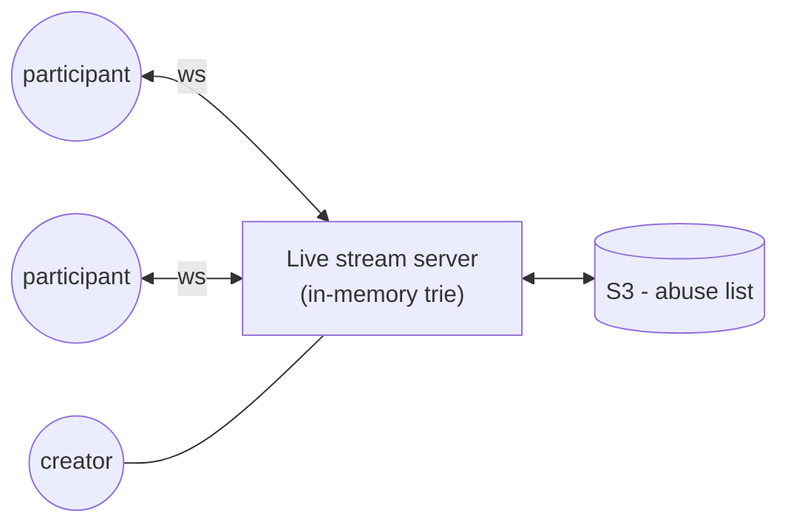
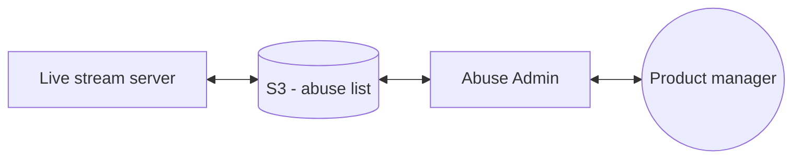

# 4. Designing Realtime Abuse Masker

[← 3. Designing a Notification Service](../case_studies/03-designing-a-notification-service.md) · [🏠 Index](../README.md) · [5. Designing Tinder Feed →](../case_studies/05-designing-tinder-feed.md)

---

> **Motive:** Not everything is a service.

Say, one video live stream is powered by one server. All participants part of that live stream (max 100) are connected to the same server. In this live stream people can send text messages (broadcast).

We want to ensure abuses are masked: `s***` / `f***`.

### Understanding Architecture
- live stream of creator is captured over **RTMP**
- participants are connected to the server over **WebSocket**
- participant can send message to all

### How Socket.IO works?
Socket.IO has a notion of **rooms**. Simple Socket.IO process is running on server.
- We create a "room" for this live stream
- Participants join the room
- When message is sent to room, Socket.IO sends to all

### Abuse Dictionary
Assume that we have a list of words (abuses) stored in a text file on Blob storage like S3 (at a path).
Hence, when the live stream server starts up:
- downloads the abuse file
- loads it in memory → **how and which data structure?**

### Masking the abuse
Given all the messages of one live stream will go through the same server, we have to find some logic that efficiently detects and masks.

**Approach 1: Tokenize and lookup**
1. Load all abuses in dictionary (hash table / set)
2. Tokenize incoming text message
3. For each word, check if it is in abuse dict
4. If yes: mask and update the token
5. If no: copy the token

This is a simple approach but not efficient:
1. tokenize (text to list of tokens requires extra space)
2. string lookup is expensive

**Approach 2: Trie**
We can build a trie out of abuses and in just O(n) traversal mask the abuses (e.g. `s → h → i → t$` with end marker).
- For each character in text we iterate through trie
- Every time we get `' '`, `','`, `';'`… etc. we reset our trie iteration (to the top)
- If the abuse is found and next char is EOS or non-alphabet, we mask and write to the new string. Else the word is copied as is.
- The final string is then sent/broadcasted to every participant.

e.g. *"mondays are s\*\*\*."*

### How this fits into the system?
We typically think of databases and all to hold and query, but that is very slow for this — plus \* **no database exposes trie** \*. So, what do we do?

### Really poor way to design this system
Have an "abuse masker" service that exposes an HTTP endpoint accepting the text and returns masked version of it. The web service will have the trie loaded in memory.

> **Note:** Not everything needs to be a "service" — *think realistically*.

Disadvantages:
- making network call every text will be massively slow
  - ↳ setting up TCP connection every time (3-way handshake)
  - ↳ terminating once we get response (2-way teardown)
- for even persistent connection we incur network I/O

Hence, creating a service to clean the text is a **bad idea**.

### Better: embed it in the live-stream server
The live stream server itself loads the abuse list from S3 into an in-memory trie and masks messages before broadcasting.

### Configuring Abuse list
We need a way to update the list of abuses (internal team):
- we need a UI where abuses are listed
- we should update the abuses and push them to S3

We create **Abuse Admin Service** to take care of this.

**Exercise:** Build this!!

---

[← 3. Designing a Notification Service](../case_studies/03-designing-a-notification-service.md) · [🏠 Index](../README.md) · [5. Designing Tinder Feed →](../case_studies/05-designing-tinder-feed.md)
