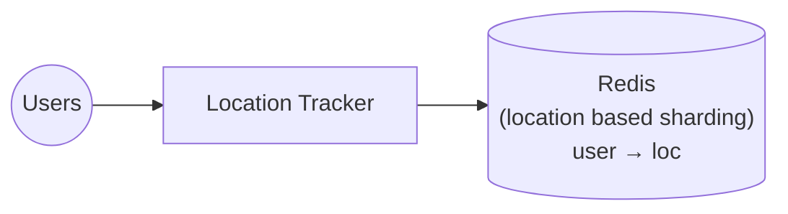
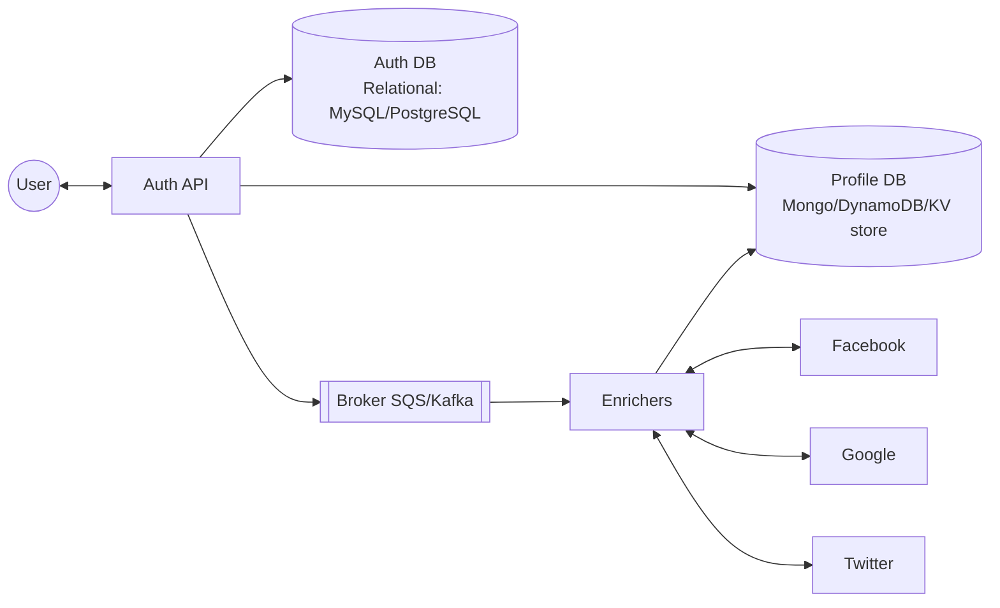
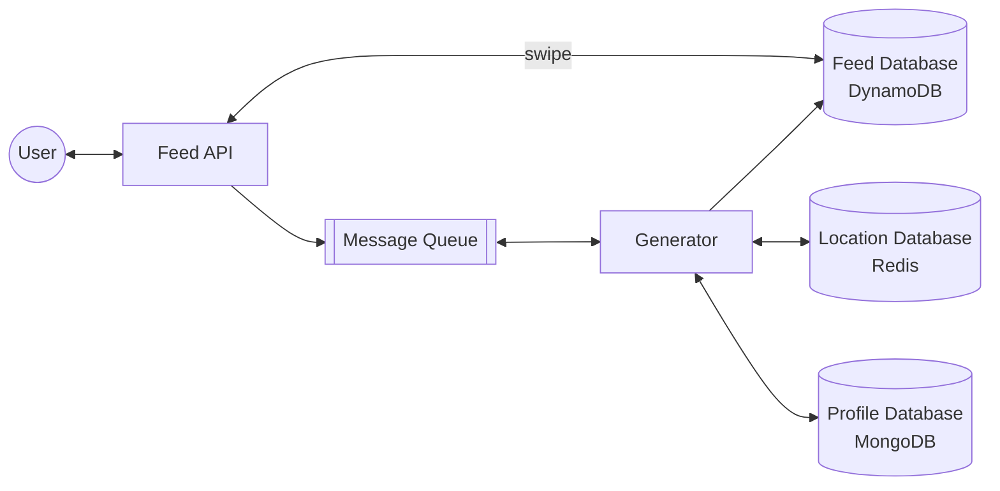
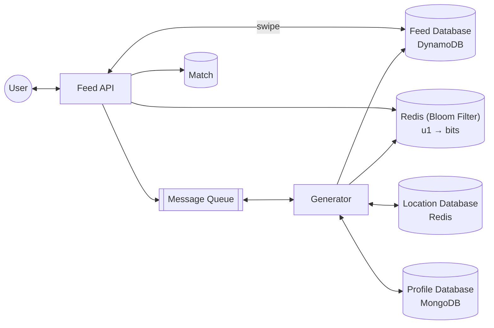

# 5. Designing Tinder Feed

[← 4. Designing Realtime Abuse Masker](../case_studies/04-designing-realtime-abuse-masker.md) · [🏠 Index](../README.md) · [6. Designing Twitter Trends →](../case_studies/06-designing-twitter-trends.md)

---

> **Motive:** playing with location and keeping things efficient.

Design Feed for Tinder and feature to swipe left or right. For a great user experience, a user should not be shown a profile that he/she already swiped.

### Feed Criteria and Preference
- **Proximity** → near the better
- **Common Interest** → shared interest

### Capturing Proximity
User's device (app) continuously emits `(lat, long)` to our backend (emits location every 30 seconds). We store this information in a database:
1. that supports **geo-spatial queries** ← generating feed
2. can be horizontally scaled through sharding ↳ handle huge incoming load (speed and query handling) and data storage is not problem as less data load

`u (32 bit) → (lat, long) (64 bit)` → 12 B × 50M users = 600 MB.

Amount of data is not the concern but the query to store and get is. **Hence we are 'sharding'.**

### Capturing Common Interest (profile information)
1. Ask user to provide those details
2. Capture the details with social login (Google / Facebook / Twitter) — authorizing for profile/interest/connection scraping

Profile DB: no standard structure across all social platforms → document/KV store.

Now that we have the interest information and current location, we can generate feed for users…

**Behaviour:** Generate feed when user is about to exhaust the current one.
- ↳ Frontend (app) will make an API call to trigger population of the feed — **better** (users swipe fast)
- ↳ maintain a feed counter in backend and check every time user swipes — slow UX

### Feed Database
Feed database can potentially explode (n×n — user × user) and will require decent storage. For each user, the DB holds Feed Items. DB should be heavily shradable (cannot be relational db).
Fetch feed item → Profile information that user has not seen before.

**Approach 1:** Store `<user_id, candidate_user_id, created_at>`
- `user_id` = hash key (we can partition by this); `created_at` = range key (ordered by)
- But whenever we are returning, we have to fetch profile info in realtime and send it to user (additional n/w call)
- Data will be partitioned by user_id.

**Approach 2:** Store `<user_id, candidate_profile, created_at>`
- we require a significant storage + risk of serving stale data
- but we avoid making call to profile service on runtime

In either case, you should **never store feed of a user as a "list"** (say MongoDB):
- ↳ it will bloat up document size on MongoDB
- ↳ expensive serialization and deserialization
- ↳ iteration is difficult

### Feed Generator
1. Should be async, because it is time consuming
2. Should be triggered by frontend

### Storing Swipes
People swipe left or right to indicate interest.
\* We do not need a separate DB to hold this info and we leverage Feed Database and just add **"is_interested"** in each item.

> **Note:** You do not have to create a new DB for everything.

When **A swipes B**:
- mark `is_interested` in feed item
- check `<B, A>` in feed DB
- if entry does not exist or `is_interested = False`: do nothing
- else: create a match (in match DB)

### Ensuring no-repetition
- When A registers a "swipe" for B
- A should never see B again in the feed
- While generating the feed, we have to check for past swipe & add only if new

We need a definite **no**; approximate yes is fine → **classic case of Bloom Filter**.
We use **Redis + periodic persist** to store swipe information. Bloom filter is consulted before adding any item to feed. ( to definitely seen before) and for each user have 10k bloom filter. - redis give sharding for bloom filter - disadvantage: even not seen few people will not visible , it says already swiped according to bloom filter.

Match: `<user_a, user_b, match_id>` ↳ This `match_id` will be used by messaging service and all messages are for a "match".

**Exercise:** explore Redis Bloom Filter; explore Redis geo queries (helps to get users in 5km radius).

---

[← 4. Designing Realtime Abuse Masker](../case_studies/04-designing-realtime-abuse-masker.md) · [🏠 Index](../README.md) · [6. Designing Twitter Trends →](../case_studies/06-designing-twitter-trends.md)
