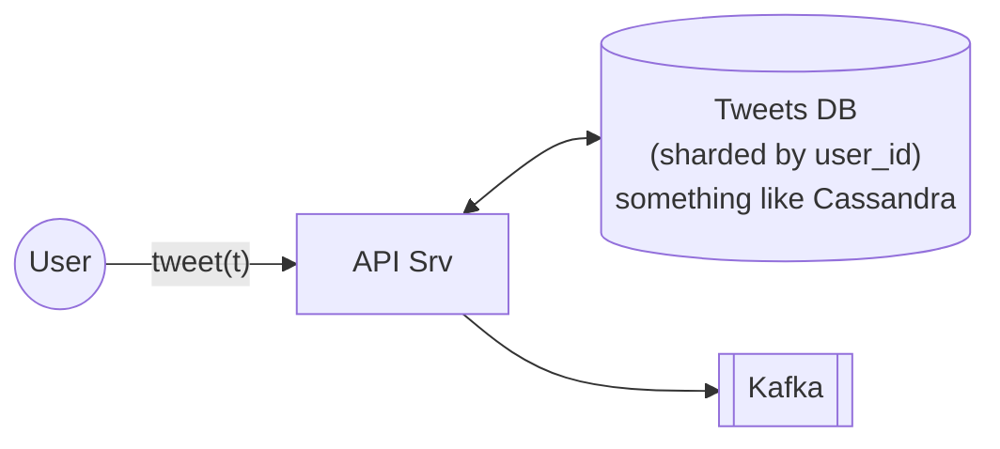
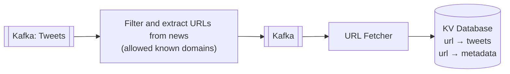
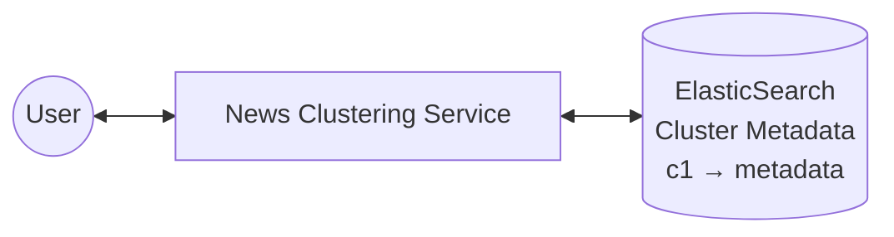
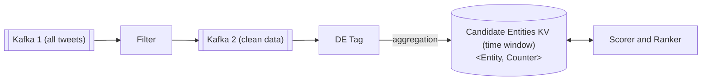
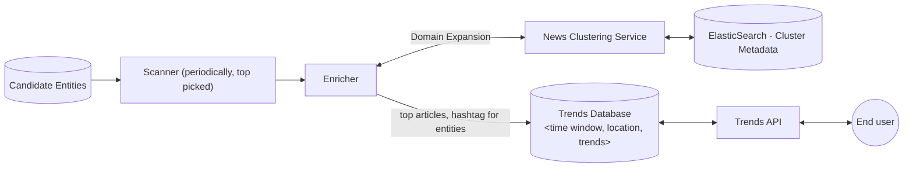

# 6. Designing Twitter Trends

[← 5. Designing Tinder Feed](../case_studies/05-designing-tinder-feed.md) · [🏠 Index](../README.md) · [7. Designing URL Shorteners →](../case_studies/07-designing-url-shorteners.md)

---

> **Motive:** To understand how "many" components are needed to build at scale.

Twitter Trends is a page/screen where people find what's happening:
- Image representing the top trend
- Trend #1 (e.g. `#sun` — Article Top, 720 tweets), Trend #2 (e.g. `#EPLwin` — Top article)
- One article about the trend (news article) representing the event
- Breaking news, entertainment, social movement

### Input to the system
In order to build Twitter Trends, we need all the recent tweets (almost realtime).
Hence, we push tweets (as soon as they are published) in a **persistent, high-throughput** message stream — **Kafka** (Durability; Volume high — 350,000 tweets per minute).

This (Kafka) becomes the input to our Trends Service.

### News Clustering
Group similar news stories into clusters. There are various clustering algorithms that can be applied like **k-means + tf-idf**.
Pre-defined hierarchy, e.g. `sports → cricket → BGT, WPL`.

URL Fetcher -> get html of that URL and stoe in DB

We have to prepare data for clustering:

### Process of clustering
The clustering algorithm uses the crawled data and builds feature vectors to cluster the articles (supervised or semi-supervised) and stores them in ElasticSearch mapped to our taxonomy.

Clusters we got are ranked as per **recency & size**. Each cluster then picks (used while rendering):
1. Top articles (media house, popularity)
2. Reference image (image from top article)
3. Keywords (common keywords from articles)

### News Clustering Service
The clusters, along with metadata (top article, keyword, top images) are stored in a database and are used to serve the trends page through News Clustering Service.

For any 'trend' the News Clustering Service is contacted to fetch the meta and top articles to render.
Given a "query", find the matching clusters [used by trends, search, and discover feature of the application].

### Find what's trending
Trending **entities** (not just hashtags) are computed for a domain, location, and topic. e.g. we see *WPL, IND vs AUS* trending and not just hashtags.

In order to find what's trending, we have to:
1. prepare the data
2. extract domain, entity and aggregate
3. score and rank

If we consider every tweet to find what's trending, then it becomes easy to **game the system**. Hence, it is important to filter out "spam" — replies, low quality tweets, tweet with sensitive content, multiple tweets by same person.

- Using **Named Entity Recognition** and **WordNet**, we tag entities to every "clean" tweet.
- Aggregation: `<Entity, Counter>` (for a given time range).
- Scorer and Ranker scores the entities as per "popularity", frequency and widespreadness and updates back in the DB.

Thus, the candidate database now holds, in a given time range, the entities that are popular along with their scores.

### Serving the trending

Each trend contains:
- entity
- domain
- metadata → top tweets, top articles, statistics

Instead of looking at one huge diagram, it is better to look at one small subsystem at a time and explore it in depth.

### Exercise
- Create a complete diagram of this system
- Explore clustering algorithms
- Pick a text/news clustering problem on Kaggle and solve it

# Twitter Trends: How It Works

## 1. Short Overview

1. **Tweets come in.** The API server saves each tweet in the Tweets DB. It also publishes the tweet to Kafka, which handles about 350K tweets per minute and keeps them durable. Everything downstream reads from that stream.

2. **Two pipelines read the stream:**
   - **News clustering** (this gives each trend its articles and image):
     - A filter keeps only tweets with links to known news domains.
     - The URL Fetcher downloads those pages.
     - A clustering job (k-means + tf-idf) groups similar articles into clusters.
     - Clusters are ranked by recency and size, then stored in ElasticSearch with their top article, image and keywords.
   - **Trending entities** (this decides what is trending):
     - A spam filter drops replies, low-quality tweets, sensitive content and repeat tweets from one person. Without it the system is easy to game.
     - The entity tagger (NER + WordNet) marks each clean tweet with entities such as "WPL" or "IND vs AUS".
     - A counter tracks `<Entity, count>` per time window.
     - The Scorer and Ranker scores entities by popularity, frequency and spread.

3. **Serving the trends.**
   - A Scanner periodically takes the top entities.
   - The Enricher asks the News Clustering Service for each entity's top articles and image, and adds hashtags.
   - The result goes into the Trends DB, keyed by time window and location.
   - The Trends API reads that DB and returns the trends page to the end user.

Kafka lets the clustering and trending pipelines work from the same tweets separately. The Trends DB means a page request only reads precomputed results.

---

## 2. Tweet vs Article

**Tweet:** a short post written by a user, up to about 280 characters. For example: *"What a win! #INDvAUS https://thehindu.com/sport/india-beat-australia"*. It is mostly opinion or reaction and is often noisy.

**Article:** the full news story that sits behind a link in a tweet, such as the page on The Hindu with the headline, body text and image. It is written by a publisher and holds the actual facts.

| | Tweet | Article |
|---|---|---|
| Written by | any user | a news publisher |
| Length | very short | long, full text |
| Content | reaction or opinion, noisy | facts, structured |
| Image | maybe | has a proper main image |
| Used for | counting what is popular | clustering and display |

**Why the system clusters articles and not tweets:** tweets are too short and messy to group reliably. Ten different tweets that link to the same match report all point to one article with real text. Clustering the article text with tf-idf and k-means works much better. Tweets then join the cluster through their link.

So the URL Fetcher exists to turn "a tweet with a link" into "the full article text", so the system can cluster it and show its headline and image on the trends page.

---

## 3. What the Trending Page Shows

For each trend (a row or card on the page):

| Item | Where it comes from |
|---|---|
| **Trend name**, e.g. `WPL` or `IND vs AUS` (not just a hashtag) | Trending entity, from the entity counter and ranker |
| **Rank** (#1, #2, …) | Score from the Scorer and Ranker |
| **Tweet count**, e.g. "720 tweets" | The `<Entity, Counter>` for the time window |
| **Category / domain**, e.g. sports → cricket | The taxonomy from clustering |
| **Reference image** | Image from the cluster's top article |
| **Top article**, such as The Hindu with a headline | The cluster's top article, picked by media house and popularity |
| **Keywords** | Common keywords across the cluster's articles |
| **Top tweets** | Tweets that linked to those articles |

The list changes with the time window and the user's location.

---

## 4. How Clustering and Trending Connect

The articles are what get clustered, not the tweets. Each tweet is attached to its article through the URL.

1. **Clustering side:**
   - The URL Fetcher downloads the page behind each news link (The Hindu and similar known domains).
   - Articles with similar content are grouped into a cluster, for example "India vs Australia match".
   - Each cluster stores its top article, image and keywords.
2. **Trending side:** the entity counter finds that "IND vs AUS" is spiking, for example with 720 tweets.
3. **Mapping:** the Enricher takes the trending entity and asks the News Clustering Service for the matching cluster. It then joins the entity (name, count, rank) with the cluster's article, image and keywords and saves the result in the Trends DB.
4. **Page load:** the Trends API only reads the ready-made rows from the Trends DB.

So the entity says what is trending and how big it is, and the cluster supplies the article, image and keywords shown with it.

- In shard DB, reduce cross DB queries.
---

[← 5. Designing Tinder Feed](../case_studies/05-designing-tinder-feed.md) · [🏠 Index](../README.md) · [7. Designing URL Shorteners →](../case_studies/07-designing-url-shorteners.md)
