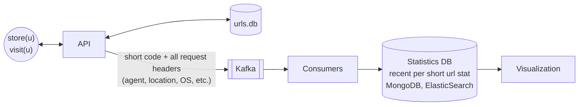
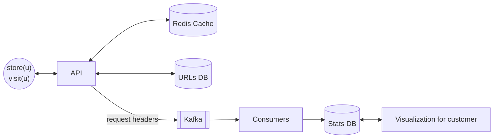
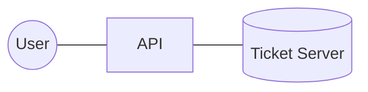
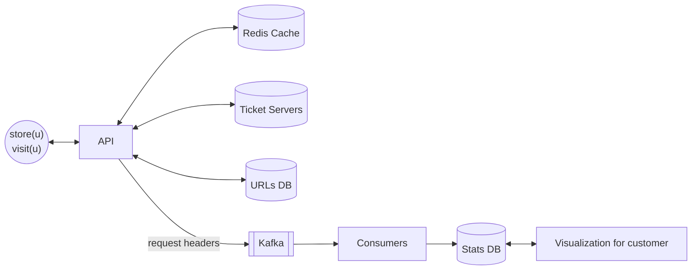

# 7. Designing URL Shorteners

[← 6. Designing Twitter Trends](../case_studies/06-designing-twitter-trends.md) · [🏠 Index](../README.md) · [8. Designing PasteBin (GitHub Gist) →](../case_studies/08-designing-pastebin-github-gist.md)

---

> **Motive:** Understand partitioning, sharding & out of the box solution.

Design a URL shortener that generates **pseudo-random human readable short URLs**. Upon visiting, takes you to original website.
- Why? easy to share in SMS
- ~100M URLs per month
- ✗ no support for custom alias

---

- should be unique 
- no one should predict

### How to shorten a URL?

**Approach 1: Hash the URL**
SHA256 is 256 bits long = 16 B → `url.sml/abcdefghijklmnop` (16 characters)
- 16 B short URLs are not short
- Two URLs can have the same hash (\* but different users can shorten the same URL)

**Approach 2: Integer ID as short**
If URL stored in DB is at ID 1729 → `url.sml/1729`
- very short but **predictable**
- someone can easily scrape all shortened URLs

**Approach 3: Custom Encoding**
Given we cannot expose integer directly, what if we encode (convert) them to strings?

Total unique characters in short URL = (a-z) + (A-Z) + (0-9) = 26 + 26 + 10 = 62 ≈ 2⁶.
We define the map that maps each of 6 bits to a character:
```
000000 → a
000001 → b
000010 → c
000011 → d
```

### Our encoding scheme
Say a user is storing some URL and when we stored it in the DB, ID that was assigned was **79** (auto-inc id / self assigned).
`79 → url`, but what is sent to user is `sml.url/bp`:
- 79 is converted to binary → `1001111`
- Left pad the value until it becomes multiple of 6 → `000001 001111` → `b`, `p`
- short url ⇒ `url.sml/bp`

But this is still predictable, so what can we do?
We define a **random map of assignment** (that only we know):
```
000000 → q
000001 → d
000010 → e
000011 → A
```
This makes our small URL very difficult to guess.

But if one fires 50 back-to-back requests, one would know the pattern and reverse engineer the encoding (our custom encoding).
**So, instead of picking sequential ID, we pick random ones?** This will form the crux of our approach!!

Up until now, we do have **ID → human readable code (short)**.

### Storage
We store mapping b/w short URL and actual URL in database.

Schema: `urls`
| short_code | url | … some other meta data |
|---|---|---|
| bpqA29 | https://… | |
| a2Am6 | https://… | |

*Note: short codes are not derived from URL.*

Given our access pattern is just KV based, we can store these in any KV store that is **partitioned by `short_code`**. We can pick any KV store or even relational DB to hold this.

Amount of data per month = 100M users × (8 + 120 characters) (code + url) = 128 × 100M = **12.8 GB**
→ **Storage is not the concern, we shard to handle load.**

- Bit to GB = bits/ 8 * 10^9
- Bytes to GB = bytes/ 10^9
- Bit to MB = bits/ 8 * 10^6
- Bytes to MB = bytes/ 10^6

- 128 bits x 10^8 count of URls generated per month = 12.8 * 10^9 bits = 12.8 GB data

### What happens when someone visits `url.sml/bp`?
- When someone visits the URL, the request comes to our API server
- We get the actual URL from the shard (`SELECT * FROM urls WHERE short_code = ?`)
- We return **301 redirect** with this URL ↳ this would ensure user is redirected to original URL

But before returning the 301 status code, we **emit an event to register the analytics**.


Statistics DB: any DB good with aggregations works (\* unstructured).

### Caching
Newly published URLs are more likely to see hits — we cache the short URLs that are "new" or hit "popular" (good use case to fit the cache in arch to reduce load on DB and improve latency).

### Visualization for end user
We leverage aggregation feature of stats DB to render fancy visualization for end users.


*Note: Stats DB is sharded by user who created the URL. Aggregations are mostly per user and we leverage Grafana to render them.*

### How is short code/URL generated?
- If we go one by one… easy to predict the next one
- Generating random integer is prone to collision ↳ hence we have to do it **uniquely pseudo-random**
- Only one machine should not be handling this ↳ too much load on one machine
  - 100M url per month/30 = 3M per day = 125K per hour = 2K per minute (average); peak will be way worse

We leverage **partitioning, sharding and transactions** to achieve this!! Not about data it is load.

We set up a few database servers having a job to issue **one random integer (unique, non-repeating) atomically**:
- *random* → making it difficult to guess and reverse engineer the logic
- *atomically* → no matter how many requests hit the database at once, there will be no collisions

### Ticket Servers
On a smaller scale (0 to 1000), say we partition it in 4 ranges (one DB handles this):

| start | end | current |
|---|---|---|
| 0 | 250 | 0 |
| 250 | 500 | <del>250</del> 252 |
| 500 | 750 | <del>500</del> 501 |
| 750 | 1000 | 750 |

`current` → the value that will be returned if read from the partition.

### Getting a random integer

1. User wants short URL
2. API server picks ticket server ↳ server knows available range ids (configuration or fixed)
3. API server selects one range at random
4. API server (in a transaction):
   - selects the 'current' of the range
   - increments current by 1 if `end != current`

```sql
-- TXN
SELECT * FROM ranges WHERE id = ?;
UPDATE ranges SET current = current + 1 WHERE id = ?;
COMMIT;
```
If range is exhausted, server removes the range (id) from its in-mem store (table).

Example: random picks give `{500, 0, 750, 501, 250}` — ranges' `current` move 0→1, 250→251, 500→501→502, 750→751.

if pick 0, the 000000 is binary increases <del>0</del> 1
- 0 => bits 000000 000000 => aa => url.com/aa

Because we are picking one random range, we see a **pseudorandom order** (\* within range the order is sequential).
Now once we have the "random id", we encode and store mapping of short url & original in urls DB.

### Capacity math

#### 32 BIT

We take max IDs we would support, say **4 Billion** (2³² range). At 100M per month consumption, it would take 40 months ~ 3 years to exhaust the range.

- 10^9 => 1 billion ~ 1000 million => 10^6

#### 64 BIT  

If we want to support more, we increase int to **64 bits**, giving us a range till 2⁶⁴ = 1.84 × 10¹⁹, and it would take
2⁶⁴ / (100 × 10⁶) = 1.84 × 10¹¹ months ≈ 0.1533 × 10¹¹ years = 15.33 × 10⁹ years = **15 Billion years**.


64 bit number ≈ 66 bit ≈ **11 char** (encoded).

But if we want to restrict the short code length, just reduce the bits. Also, instead of starting from 0, let's do it from 100,000 to have short code of length at least 3.

Say we want short code **min length = 3, max length = 8**:
- min len = 3 char = 3 × 6 = 18 bits = 2¹⁸ ~ 100,000 (min, with pad zero)
- max len = 8 char = 8 × 6 = 48 bits = 2⁴⁸ ~ 5.62 × 10¹⁴ (max value)

Say we want each range to exhaust in 1 year, so it generates 100M × 12 = 1200M URLs = 1.2 × 10⁹ integers.

Total ranges = 5.62 × 10¹⁴ / 1.2 × 10⁹ ≈ 4.5 × 10⁵ ~ **500,000 ranges** (each range 1.2 × 10⁹ int).

Now we have **500k** ranges:
```
100k  to 1200M
1200M to 2400M
2400M to 3600M
...
```
To start with, we create these entries in DB and upon getting request, pick one range at random & get one int out of it.

If one ticket DB becomes a bottleneck (500k rows can handle ranges data but not load), we spin up a new DB and move some ranges there. Now API server will pick one ticket server at random.

API server know how many ticket servers are there and know each ticket server contain how many ranges are there, so they know what ticket server and range to select in random.


\* We can play with range length to make short URLs look random: 3 char first, once about to exhaust then 4, then 5, and so on.

### Exercise
- Implement the encoding scheme we discussed
- Explore analytics we can capture and how during short URL hit
- Explore how exactly we share analytics data
- Implement ticket server for short range (0, 1000)

---

[← 6. Designing Twitter Trends](../case_studies/06-designing-twitter-trends.md) · [🏠 Index](../README.md) · [8. Designing PasteBin (GitHub Gist) →](../case_studies/08-designing-pastebin-github-gist.md)
