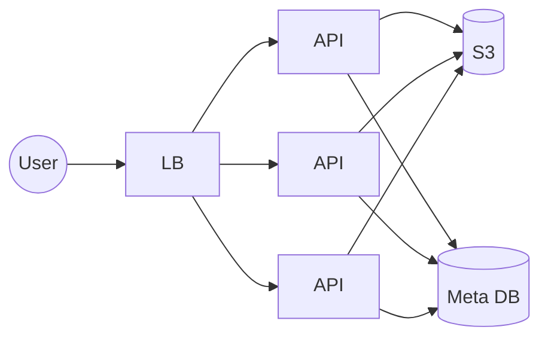
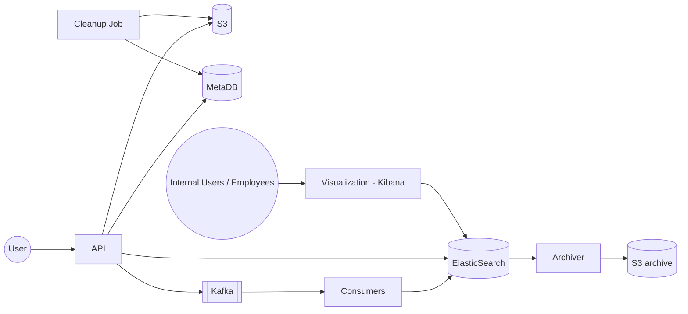

# 8. Designing PasteBin (GitHub Gist)

[← 7. Designing URL Shorteners](../case_studies/07-designing-url-shorteners.md) · [🏠 Index](../README.md) · [9. Designing Fraud Detection →](../case_studies/09-designing-fraud-detection.md)

---

> **Motive:** Not storing derivables, cost effective design.

PasteBin is an online platform that allows you to:
- store any text file (content)
- share it with anyone (publicly or secretly) — public to anyone / anyone with the link
- set an expiration for auto deletion
- URL generated for a paste is unique
- file stored can be long (but not huge) (10 MB max)
- one who created the paste can edit it as well

### Where should we store the file?
We have two options: Database or Blob store like S3. To decide which one, let's crunch some numbers:
- Max size per file = 10 MB
- Say #writes = 10M per month
- Total storage req = 10M × 10 MB = 10,000,000 × 10,000,000 B = **100 TB (per month)**
- Typical write to read = 1 : 50
- Total data read = **5 PB (per month)** (bandwidth requirement)

Since data is huge & per file size is long enough, there is no rationale to store this on a database.

### Storage
We store the files on **S3** and metadata on **Relational DB**.

Schema: `store`
| uid (36) | name (120) | createdAt (4) | visibility (4) | owner_id (4) |
|---|---|---|---|---|
| uuid | | | PUBLIC / SECRET | |

10M × (36 + 120 + 12) = 10M × 168 = 1680 MB = **1.6 GB (per month)** → handle-able by simple relational database.
\* We could also go with KV store like DDB. Do sharding and if relational DB used do sharding if needed as we need for load for now not for data only when it grow huge.

### API and Compute
For uploading and accessing the files we need API servers. One will not be enough, hence we add many behind load balancer.

> **Note:** we did **not** store S3 path in relational DB (metadb).

On S3, we configure our bucket: `gist-paste`. When user 1729 uploads the file with uid `71293564`:
1. File is sent by the user to API server on HTTP POST
2. API server gets the file
3. API server generates a random UUID
4. API server uploads file to S3 at `s3://gist-paste/1729/71293564`
5. API server makes an entry in meta DB
6. API server returns response

| uid | name | createdAt | visibility | owner_id |
|---|---|---|---|---|
| 71293564 | abc.txt | — | PUBLIC | 1729 |

Name is just display file on UI.
> **Note:** avoid storing something that can be derived in the database. Cost effective changes.

### URL of the file
The URL through which we would access the file would be `https://gist.github.com/71293564`.
Read request flow is straightforward (\* S3 path created from entry): User → API → MetaDB → S3.

### Cache
There might be some files that are frequently accessed, so should we cache them to improve user perceived latency?
We are for sure tempted to do so, but is it worth it?
- "frequently" → how much? 1:50 is okay (write:read)
- 10 MB is huge for a cache ↳ cache stores in RAM ↳ pretty expensive

If the frequency is not "huge", it does not make sense to cache the file. As a one-word answer: **No!!**
I would rather prefer to serve 10 requests from S3 than add an expensive cache and maintain it. But be open to understanding user behaviour and access pattern.

### Expiration
Owner of the file can set expiration to a file, post which it becomes inaccessible and eventually deleted.
- We add **"expiration" column**.
- When file is accessed, we first check expiration time. If beyond → return 404; else: fetch and return.
- Run a simple **cleanup job** that cleans up expired files from meta DB and S3 (maybe it runs once a day…).

### Fault Tolerance
Take periodic backup of MetaDB and store it on S3. This would help us with disaster recovery & recovering from data loss.

### Analytics
Whenever a file is accessed, the API server captures the request metadata and stores it on **ElasticSearch** for end-user analytics ↳ good for recent analytics, aggregation and visualization (sharded out of the box).

Cleanup job check what data are expired then it will delete it from metadata and S3

Given analytics data is huge & we may not query it beyond 6 months → **archive to save space**.

### Exercise
- Capture request data (IP, region, user agent, etc.) and dump it in ElasticSearch
- Build visualization on top of it with Kibana
- Write a small cleanup job that periodically batch deletes the data from Relational DB (compare)
1k 10k 100k batch size and one by one compare

---

[← 7. Designing URL Shorteners](../case_studies/07-designing-url-shorteners.md) · [🏠 Index](../README.md) · [9. Designing Fraud Detection →](../case_studies/09-designing-fraud-detection.md)
