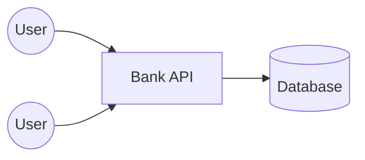
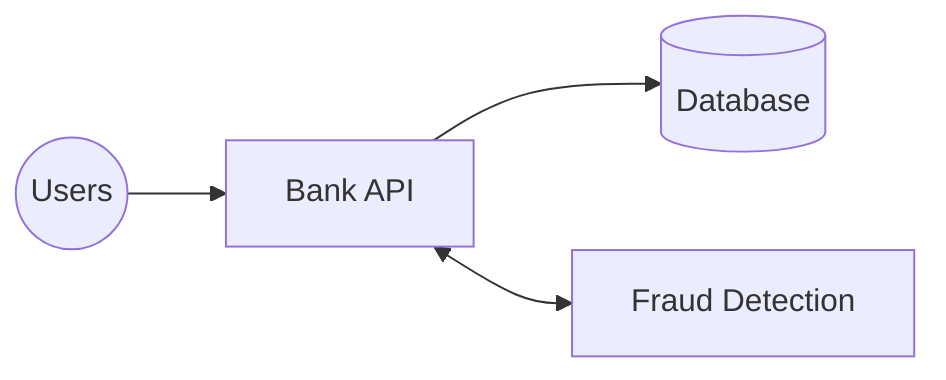
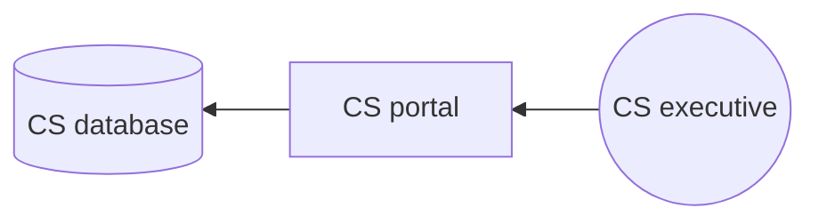
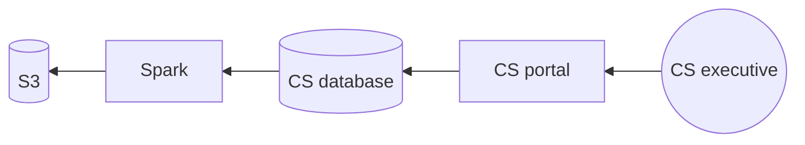
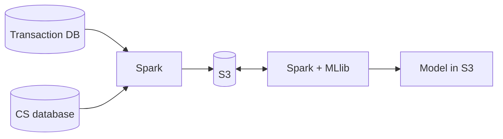
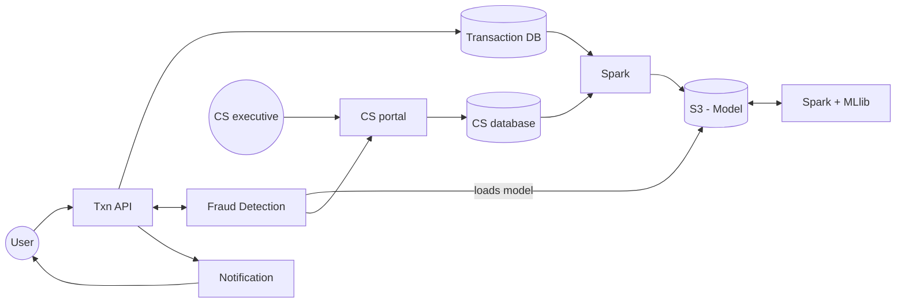

# 9. Designing Fraud Detection

[← 8. Designing PasteBin (GitHub Gist)](../case_studies/08-designing-pastebin-github-gist.md) · [🏠 Index](../README.md) · [10. Designing a Recommendation Engine →](../case_studies/10-designing-a-recommendation-engine.md)

---

> **Motive:** Designing systems using Big Data Technologies.

Financial transactions are risky and prone to frauds. Banks have to deploy fraud detection system, that can:
1. detect fraud in realtime
2. block the transaction (to take consent)
3. inform a customer support executive

When a user initiates the transaction, the bank makes an entry, but before proceeding further, it **checks for a potential fraud**:
- if not a fraud: **allow the transaction**
- otherwise:
  - hold the transaction
  - involve the executive
  - call the customer and confirm
  - if customer says yes: allow the transaction
  - otherwise: abort

### Storage
We need an ability to register a transaction:

| source_acc | target_acc | status | … (ip, region, location, target bank, etc.) |
|---|---|---|---|

`status`: INITIATED / BLOCKED / FRAUD / ALLOWED / DONE / FAILED

Given the schema is simple enough, choice of DB is not that complex. **We start with relational** (data is also "shardable").
\* We can drop foreign key constraints here!

### Bank API (Txn API)

*Note: Bank API is a set of servers behind a load balancer.*

Transaction handler (HTTP req):
1. get source & target entry
2. extract details like (IP, location, user agent) from HTTP request
3. send these details (**synchronously**) to fraud detection

Fraud Detection is a simple HTTP based service that:
1. gets transaction and request details (over HTTP)
2. returns if it is fraudulent or not

> **Note:** Fraud detection service should respond within **200 ms**.

### Fraud Detection Algorithm (Decision Trees / Random Forest)
Fraud Detection Service uses multiple parameters to judge if current transaction is fraud or not.
We generate a lot of decision trees (random forest) from the training data and train the model. Every transaction is classified into either **Fraudulent** or **Non Fraudulent**.
- tree 1 (loc + time), tree 2 (loc + bank), tree 3 (time + user + bank)
- New txn is classified across all & **majority** is considered.

### Preparing the data for training
Who knows which transactions were fraud? → **Customer support and complaint portal**. We need to fetch transactions that had some fraud dispute.

We write a job that periodically processes the data from the CS database, extracts the fraud transactions, communication summary, details shared on ticket — puts them in a blob storage like S3.

We use big data processing tools like **Spark** to move data to S3:

The amount of data moved from DB to S3 is huge and hence we need distributed computing. One machine reading from S3 and transforming and writing to S3 will slow down the system.

To train our model, we need data, the details about the transaction — who sent to whom, from which IP, location, region, currency, etc. — **all this is present in transaction DB**.

Similar to moving data from CS DB to S3 we used Spark, we will move data from Transaction DB:

Now that all the data we want to train the model is in S3, we use any distributed ML processing libraries to build the model, e.g. using **Spark + MLlib** to train our "Decision Tree" and put the model back in S3 ↳ just a file holding the serialized version of decision tree.

### Fraud Detection using the model
Fraud detection service is a simple HTTP service that:
1. loads the model from S3
2. creates in-memory structure to classify the transactions
3. exposes API to do this synchronously

The end-user facing transaction API invokes Fraud Detection to understand if it is fraudulent or not:
- if not, then transaction proceeds
- if yes, customer service is involved & notification is sent to user

### Exercise
- Write a small Spark job that extracts data from DB and puts them on local disk in multiple JSON files
- Understand and write a random forest classifier
- Explore MLlib + Spark to plug random forest

---

[← 8. Designing PasteBin (GitHub Gist)](../case_studies/08-designing-pastebin-github-gist.md) · [🏠 Index](../README.md) · [10. Designing a Recommendation Engine →](../case_studies/10-designing-a-recommendation-engine.md)
